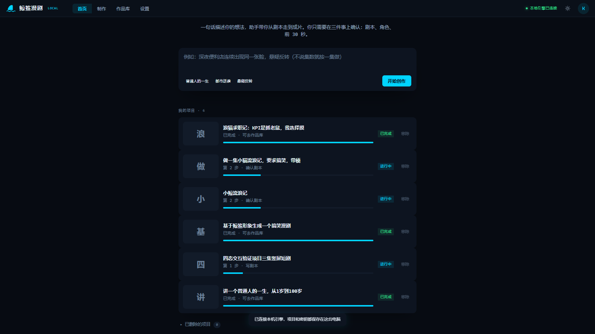
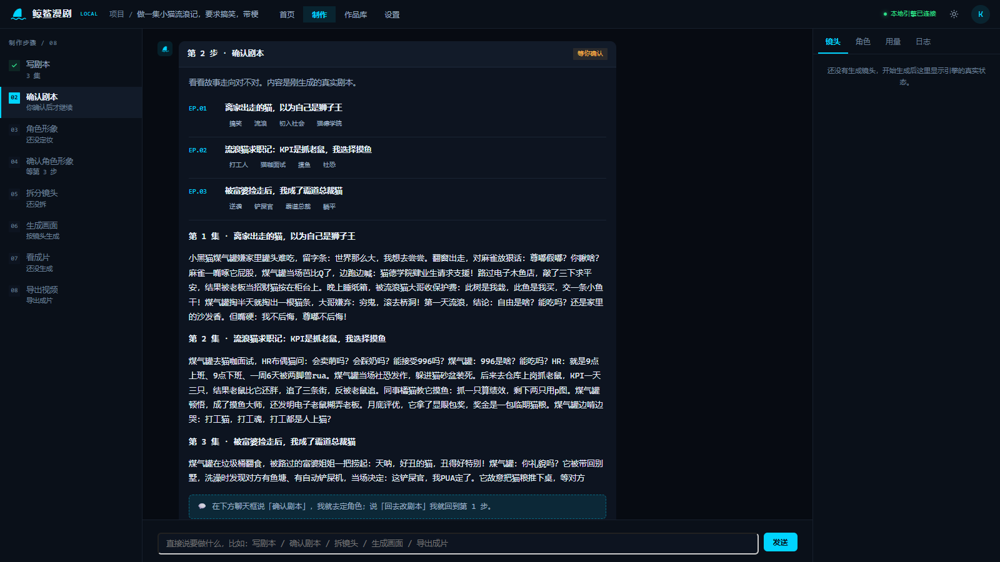
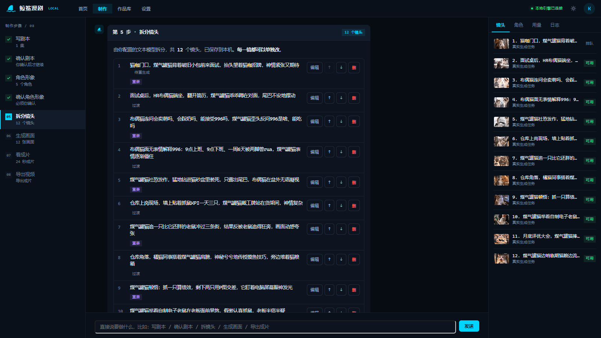
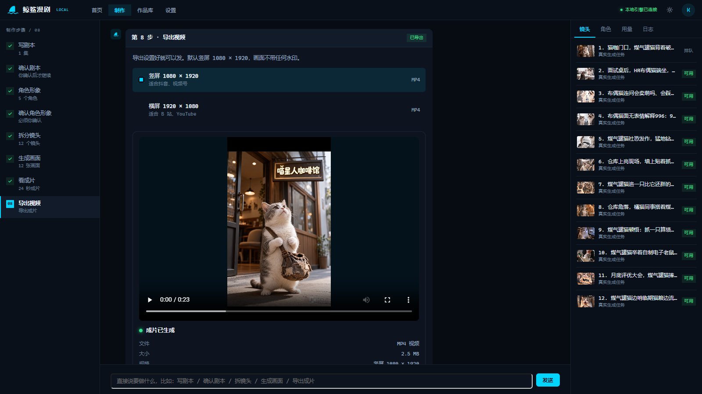

<div align="center">
# 🦈 WhaleJu · 鲸鲨漫剧
**本地优先的开源 AI 漫剧生产流水线**
**Local-first AI Motion-Comic Pipeline**
一句话创意 → 剧本 → 分镜 → 角色 → 生图 → 生视频 → 配音 → 成片导出，全程在你自己的电脑上完成。
`纯开源免费` `数据不出本机` `自带密钥直连厂商` `MIT License`

</div>
---
## ✨ 这是什么
WhaleJu 是给**已经注册过即梦/可灵等模型账号、却没做出过一部完整短剧**的创作者准备的桌面工具：
- **对话式 Agent 驱动**——不用在界面里到处找按钮，在聊天框说「确认剧本」「拆镜头」「生成画面」「导出成片」，Agent 就帮你办；每一步执行过程实时逐段可见
- **8 步制片流程**——写剧本 → 确认剧本 → 角色形象 → 锁定形象 → 拆分镜头 → 生成画面 → 看成片 → 导出视频，三道检查点（CP1/CP2/CP3）人工把关，绝不自动跳
- **所见即所得**——剧本逐集可编辑、分镜支持增删/排序/行内修改、每个镜头的图和视频即时预览、单镜不满意单独重生成、成片导出后立刻播放

## 🔒 隐私与成本：两条底线
| 底线 | 做法 |
|---|---|
| 数据不出电脑 | 项目、素材、成片全部落本机磁盘（SQLite + 文件目录）；密钥 AES-256-GCM 加密存本机系统凭证库，任何接口不回显明文 |
| 不经手你的钱 | 本软件**免费开源、没有任何收费环节**。生成消耗的是你自己的厂商额度——引擎带着你的密钥 HTTPS 直连厂商，中间没有平台、没有代理、没有账本 |

## 🚀 快速开始
### 环境要求
- Windows 10/11（macOS 理论可跑，未验证）
- Python 3.11+、Node.js 18+、Rust（Tauri 构建）
- 至少一家模型厂商的 API Key（文本模型必需；图片/视频/配音按需）
### 从源码运行
```bash
# 1. 引擎（Python FastAPI，127.0.0.1:7420）
python -m venv .venv
.venv/Scripts/pip install -r engine/requirements.txt
.venv/Scripts/python engine/run.py
# 2. 前端（Vue3 + Vite）
cd desktop/web
npm install
npm run dev          # 浏览器预览模式，自动连 7420
# 3. 桌面壳（Tauri，可选）
cd desktop
npm install
npm run tauri dev
# 4. 测试
.venv/Scripts/python -m pytest engine/tests -q   # 142 passed
```
### 第一次使用
1. **配置模型**——设置页四个能力槽（文本/图片/视频/配音）逐个填服务地址、模型标识、密钥，点「测试连接」通过才能用
2. **创建项目**——首页一句话描述你的想法（支持「只做一集」「共 3 集」等集数表达），Agent 按集数开工
3. **跟着聊天走**——每步确认后推进，卡住了直接在聊天框问 Agent

## 🧭 界面导览
| 步骤 | 能做什么 |
|---|---|
| ① 写剧本 | 一句话想法 → Agent 分集写剧本；支持「写第 2 集」逐集推进省 token |
| ② 确认剧本 | 人工把关；不满意说「回去改第 1 步」Agent 带着上下文重写 |
| ③ 角色形象 | 按剧本生成候选定妆图，挑选后锁定（锁定 = 后续镜头的一致性锚点） |
| ⑤ 拆分镜头 | 剧本切 12+ 镜头；**每个镜头可单独编辑描述、调整顺序、增删** |
| ⑥ 生成画面 | 按镜头逐个调厂商 API；失败自动退避重试、自动换源，失败镜头单独重生成 |
| ⑧ 导出视频 | 竖屏 1080×1920 成片，AI 生成声明写入元数据与发布文案（不烧进画面） |

## 🏗️ 架构一览
```
desktop/                 # Tauri 2 + Vue3 桌面应用
├── web/src/             #   前端源码（Pinia stores + 组件）
└── src-tauri/           #   Rust 壳：引擎 sidecar 管理、IPC 鉴权
engine/                  # Python FastAPI 本地引擎
├── app/workflow/        #   8 态状态机 + 三检查点 + 断点恢复
├── app/agent/           #   对话 Agent（工具白名单 + 意图改写）
├── app/adapters/        #   厂商适配（OpenAI 兼容协议，Registry 路由）
├── app/storage/         #   SQLite + 素材索引 + 凭证加密
├── app/publish/         #   发布套件（文案 + AI 声明 + ffmpeg）
└── tests/               #   142 个测试，全部离线可跑
docs/                    # 设计合订本 v3.2 + 启动调试手册
```
- **技术栈**：FastAPI · SQLite(WAL) · Vue 3 · Pinia · Tauri 2 · SSE · ffmpeg
- **设计文档**：[`docs/鲸鲨漫剧-系统设计方案-合订本-v3.1.md`](docs/鲸鲨漫剧-系统设计方案-合订本-v3.1.md)（架构 4+1 视图 / 11 表 DDL / 状态机 / 接口契约）
- **调试手册**：[`docs/鲸鲨漫剧-启动与调试手册.md`](docs/鲸鲨漫剧-启动与调试手册.md)（启动/配置/错误码/故障排查）
## 🤝 参与贡献
欢迎 PR！上手建议：
1. Fork → 分支 → 改代码 → `pytest engine/tests -q` 全绿 → 提交
2. 提交信息用中文 Conventional Commits（`feat:` / `fix:` / `docs:` …）
3. 好动的方向：新增厂商 adapter（实现 `adapters/base.py` 的 Protocol 即可，不改 Registry）、macOS 支持、配音/音乐环节、i18n
> ⚠️ 内容合规提醒：用本项目生成的内容请遵守所在平台规则——AI 生成内容需标识、微短剧需备案、低俗同质化内容会被平台打击。引擎内置合规 Never 层做输入拦截，但合规主体是你。
## 📄 License
[MIT](LICENSE) © 2026 kujirashark
---
<div align="center">
**WhaleJu** — 一条鲸鲨，驮着你的漫剧工作室，游在本地。
</div>
