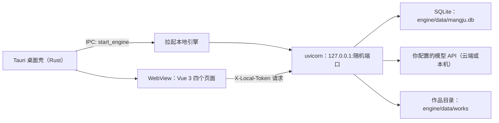

# 鲸鲨漫剧 · 启动与调试手册
> 适用版本：`v0.1.0`（设计基准 `docs/鲸鲨漫剧-系统设计方案-合订本-v3.1.md`，去演示化改造 2026-11-20）
> 面向对象：首次运行的人、改前端/后端代码的人、排查"为什么跑不起来"的人
>
> **一句话原则**：这个软件没有任何演示数据。剧本、图片、视频、成片全部来自你自己在「设置」里配置并**真实测试通过**的 API；没配置就明确报错，不会假装成功。
>
> `engine/README.md` 记录的是 W1–W4 早期历史状态（其中 Mock、桌面壳未搭建等描述已过时）。**启动与配置请以本手册为准。**
---
## 0. 启动前自检清单
| # | 检查项 | 通过标准 |
|---|---|---|
| 1 | Python 3.12+ 与 `engine/requirements.txt` 依赖 | `.venv/Scripts/python.exe -m pytest engine/tests -q` → 26 passed |
| 2 | Node 22+，前端依赖已装 | `desktop/web/node_modules` 与 `desktop/node_modules` 存在 |
| 3 | Rust 工具链（仅桌面壳） | `cargo check` 通过 |
| 4 | 前端已构建 | `desktop/frontend/index.html` 存在（改过 `web/` 代码后必须重新构建） |
| 5 | 至少一个模型服务可用 | 能访问某个 OpenAI 兼容地址并有 Key（或本机已部署模型） |
| 6 | 额度充足 | 跑 12 个镜头需 **108 积分**，新库初始只有 86.4，需先充值 |
---
## 1. 软件由什么组成

三种运行方式的差别只在"谁拉起引擎、界面从哪里加载"：
| 方式 | 用途 | 引擎端口 | 界面地址 | 是否需 Tauri |
|---|---|---|---|---|
| A 桌面应用 | 日常使用、验证最终形态 | 随机端口（IPC 下发） | 桌面窗口 | 是 |
| B 浏览器调试 | 改 UI 最方便，热更新 | 固定 7420 | http://127.0.0.1:1420 | 否 |
| C 只跑引擎 | 调 API、看日志、写脚本 | 固定 7420（可自定） | 无界面 | 否 |
---
## 2. 环境准备（只需做一次）
在项目根目录 `D:\财务提效软件` 下执行（以下命令均假设在该目录；Git Bash 或 PowerShell 均可，PowerShell 把路径中的 `/` 换成 `\`）：
```bash
# 1. Python 虚拟环境与依赖
python -m venv .venv
.venv/Scripts/python.exe -m pip install -r engine/requirements.txt
# 2. Vue 前端依赖
cd desktop/web && npm install
# 3. Tauri 桌面壳依赖
cd ../ && npm install
```
> Rust 桌面壳会自动到项目根目录找 `.venv/Scripts/python.exe`（Windows）或 `.venv/bin/python`（Linux/macOS）。若你的工程放在别的盘或换了目录名，可设置环境变量 `MANGJU_PROJECT_ROOT` 指向项目根目录。
---
## 3. 方式 A：启动桌面应用（推荐）
```bash
# 先构建前端（只要改过 desktop/web/src 下的代码就要重新执行）
cd desktop/web && npm run build
# 再启动桌面壳
cd .. && npm run dev
```
启动成功的标志：
- 终端出现 `[bridge] start_engine 被调用` 与 `[bridge] start_engine 结果=EngineInfo { running: true, port: ..., ... }`
- 应用窗口打开，首页为**空状态**（没有假项目）
- 作品库为空；设置页四项能力默认「未设置」
打包安装包（生成 `.msi` / `.nsis`）：在 `desktop/` 下执行 `npm run build`。
**重要**：Tauri 加载的是 `desktop/frontend/` 里的构建产物，不是 Vue 源码。只改了源码不执行 `npm run build`，窗口里看到的还是旧界面。
---
## 4. 方式 B：浏览器调试（改界面最方便）
需要开两个终端。
**终端 1 —— 固定端口启动引擎：**
```bash
cd "D:/财务提效软件"
.venv/Scripts/python.exe -m uvicorn engine.app.main:app --host 127.0.0.1 --port 7420 --log-level info
```
**终端 2 —— 启动 Vite：**
```bash
cd "D:/财务提效软件/desktop/web"
npm run dev
```
浏览器打开 **http://127.0.0.1:1420**。
浏览器模式下前端会先请求 `http://127.0.0.1:7420/health`，再取一次 `/api/local-token` 拿令牌；令牌只存内存，不写 localStorage。**如果终端 1 没启动，界面会提示"未检测到本地引擎，请先启动鲸鲨漫剧桌面应用"**——这时启动引擎后刷新页面即可。
调试后端时优先用这种方式：**桌面壳里引擎的 stdout/stderr 被丢弃（Stdio::null），看不到 Python 日志**；浏览器方式下终端 1 能直接看到每次 API 调用与报错。
---
## 5. 方式 C：只启动引擎（API 调试）
```bash
cd "D:/财务提效软件"
.venv/Scripts/python.exe -m uvicorn engine.app.main:app --host 127.0.0.1 --port 7420
```
常用调用（Git Bash；PowerShell 请用 `curl.exe` 或 `Invoke-RestMethod`）：
```bash
# 健康检查（不需要令牌）
curl -s http://127.0.0.1:7420/health
# 取本地令牌（仅开发便利接口；桌面运行时由 IPC 直接下发）
TOKEN=$(curl -s http://127.0.0.1:7420/api/local-token | sed -E 's/.*"token":"([^"]+)".*/\1/')
# 查看四个能力槽是否就绪
curl -s -H "X-Local-Token: $TOKEN" http://127.0.0.1:7420/api/capabilities
# 查看钱包余额
curl -s -H "X-Local-Token: $TOKEN" http://127.0.0.1:7420/api/wallet
# 创建项目（想法至少 10 个字）
curl -s -X POST -H "X-Local-Token: $TOKEN" -H "Content-Type: application/json" \
  -d '{"idea":"一个普通人的一生，从八岁到七十岁，三集竖屏短剧"}' \
  http://127.0.0.1:7420/api/projects
```
引擎重启后令牌会轮换；用旧令牌调用会得到 `401`，重新取一次即可。
---
## 6. 首次使用：配置模型与充值
### 6.1 四个能力槽
进入「设置」，每一项都要单独配置：
| 能力槽 | 用途 | 实际调用的接口 |
|---|---|---|
| 写剧本、拆分镜头（text） | 生成剧本结构和分镜 | `POST {endpoint}/chat/completions` |
| 生成图片（image） | 角色定妆图 | `POST {endpoint}/images/generations` |
| 生成视频（video） | 逐镜头生成画面 | `POST {endpoint}/video/generations` + `GET {endpoint}/video/generations/{id}` |
| 配音（speech） | 语音合成 | `POST {endpoint}/audio/speech` |
### 6.2 三种来源都要填地址和模型
| 来源 | 必填 | 说明 |
|---|---|---|
| 用我自己的 API 密钥（owned） | 服务地址 + 模型标识 + 密钥 | 直连厂商，不经过平台 |
| 在你电脑上运行（local） | 服务地址 + 模型标识 | **本机没部署模型就用不了**；例如 Ollama 的 `http://127.0.0.1:11434/v1` |
| 用平台额度（proxy） | 服务地址 + 模型标识 + 密钥 | 填平台网关地址 |
> 服务地址填 **OpenAI 兼容的根地址**，例如 `https://api.example.com/v1`，不要带 `/models`，也不要漏掉 `/v1`。模型标识填厂商文档里的名称，例如 `deepseek-chat`。
>
> 选「本地」后密钥输入框会消失，这是正常的：本地来源不需要密钥，但仍必须填地址和模型，并同样要点「测试连接」。
>
> 再次编辑已有配置时，密钥框留空即可——引擎会沿用已保存的密钥；只有首次配置才必须粘贴密钥（输入框显示为空是正常的，密钥不会回显）。
### 6.3 验证：必须点「测试连接」
保存只是写入配置，状态仍是「未验证 · 不能用于生成」。点「测试连接」后引擎会真实请求 `GET {endpoint}/models`：
- 返回 200 → 状态变为「已验证可用」，`verified=1`，才允许用于生成
- 失败 → 明确显示原因（HTTP 状态码 / 连接失败信息），不会降级成"假装可用"
四个槽全部验证通过后，`GET /api/capabilities` 的 `all_ready` 才是 `true`。
### 6.4 视频接口的约定
通用适配器按上面的路径和字段与厂商通信。若厂商接口不同（例如可灵、即梦的原生协议），表现为"测试连接通过但视频一直 pending 或 failed"，需要在 `engine/app/adapters/` 增加薄适配器，业务层不用改。
视频轮询规则：`status` 为 `succeeded/success/completed/done` 且返回 `video_url/url/file` 才算成功；每 1.5 秒轮询一次，单镜头最多 120 轮（约 3 分钟），超时按失败退回冻结额度。
### 6.5 充值
新库初始余额 **86.4 积分**，跑默认 12 个镜头需要 **108 积分**（9 × 12）。点右上角余额选择套餐：`p1`=50、`p2`=200、`p3`=1000。余额不足会报 `E2001`。
---
## 7. 端到端冒烟测试（按顺序逐项确认）
| # | 操作 | 期望结果 |
|---|---|---|
| 1 | 设置页四个槽测试连接 | 全部显示「已验证可用」 |
| 2 | 首页输入想法（≥10 字）创建项目 | 进入制作台，8 步导航出现 |
| 3 | 第 1 步生成剧本 | 内容来自你的文本模型；未配置时报 `E4001` |
| 步骤门禁 | 侧栏点后面的步骤 | 提示「先完成当前这一步，再往后走」；已越过的步骤不再显示会报错的确认按钮 |
| 状态与进度 | 首页项目卡 | 显示引擎真实状态（做到第几步 / 进度百分比），不再永远停在第 1 步 |
| 4 | 第 2/3 步生成角色与定妆图 | 图片来自你的图片模型并落库 |
| 5 | 第 4 步拆分镜头 | 需要已有剧本，否则报 `E4003` |
| 6 | 检查点确认 | 挂起的检查点重启后仍要重新确认，绝不自动通过 |
| 对话驱动流程 | 底部输入框说"开始写剧本"→确认执行 | 识别为 `gen_script` 意图，确认后真实生成剧本 |
| 对话可识别的指令 | 写剧本 / 定妆图 / 拆镜头 / 生成画面 / 导出视频 / 充值 / 设置 | 均弹出确认条，确认后调对应业务接口 |
| 对话直接给内容规格 | 输入"我的第1-100岁，100集"这类**带数字+集/岁**、没有"生成"二字的话 | 识别为写剧本意图并弹确认条；确认后自动切到第 1 步并流式生成。修改类诉求（"第二集太快了""每集换脸"）不受影响 |
| 对话问答/打招呼 | 输入"你好"等无动作的话 | 助手给出能力说明，**不弹确认条**，不再出现 `answer_question 已记录` 这类内部术语 |
| 生成剧本流式输出 | 点「用我的模型生成剧本」 | 右上角状态标签同步为「生成中」，卡片只显示阶段说明 + 实时文本，不再混入空态/配置按钮；完成后显示剧本 |
| 第 1 步四种状态 | 待生成 / 生成中 / 生成失败 / 第 N 稿 | 卡片一次只呈现当前状态的信息；失败态给出中文原因 +「重新生成」「检查模型配置」，不再有"假剧本"等技术视角文案 |
| 7 | 第 6 步开始生成 | 进度来自引擎真实批次；失败项自动退回冻结额度，无"跳过等待"按钮 |
| 8 | 第 8 步导出 | 有真实视频素材才能成功；没有素材报 `E4002`（409） |
| 9 | 作品库 | 只显示真实导出的作品，带 AI 生成标识与发布文案 |
| 项目管理 | 首页项目卡片右下角「移除」→「确认删除」 | 项目从列表消失，进入「已删除的项目」折叠区 |
| 误删恢复 | 展开首页「已删除的项目」→「恢复」 | 项目回到正常列表，内容原样保留（软删不清数据） |
---
## 8. 日志与调试入口
| 层面 | 怎么看 | 说明 |
|---|---|---|
| Rust 桌面壳 | `npm run dev` 的终端 | 关键字 `[bridge]`；端口、令牌、错误信息都会打印 |
| Python 引擎 | 浏览器调试方式的终端 1，或手动 uvicorn 终端 | 桌面壳里 stdout/stderr 被丢弃，**看不到 Python 日志** |
| 引擎启动恢复 | Python 日志中的 `[recover] N 个检查点挂起` | 挂起检查点等待用户确认，不会自动推进 |
| 前端 | 浏览器 F12 / Tauri dev 模式右键检查 | 引擎调用失败会打印 `[engine] API 失败: <路径> <原因>` |
| 生成进度 | `GET /api/projects/{pid}/generation/progress` | `items[].fail_reason` 是厂商失败的真实原因 |
| 数据库 | SQLite 查询（见下） | 引擎是唯一写者，调试时可只读查询 |
只读查询示例（项目根目录执行）：
```bash
# 模型配置（不会显示明文密钥，只有密文）
.venv/Scripts/python.exe -c "import sqlite3; c=sqlite3.connect('engine/data/mangju.db'); print(c.execute('select slot,source,model,verified from model_configs where is_active=1').fetchall())"
# 项目与状态
.venv/Scripts/python.exe -c "import sqlite3; c=sqlite3.connect('engine/data/mangju.db'); print(c.execute('select id,name,status from projects').fetchall())"
```
常用表：`projects`（状态）、`model_configs`（配置/验证状态）、`assets`（素材与成片）、`credit_wallet`（余额/冻结）、`usage_events`（真实用量）、`checkpoints`（挂起点）。
---
## 9. 错误码速查
| 错误 | 含义 | 处理 |
|---|---|---|
| `401 本地引擎鉴权失败` | 令牌不匹配（引擎重启后前端仍用旧令牌） | 刷新页面重新连接，或重新取 `/api/local-token` |
| `E4001` | 没有配置/验证可用的模型 | 到「设置」填地址+模型，点「测试连接」通过 |
| `E4002`（409） | 还没有真实画面可以导出 | 先完成第 6 步生成真实视频；不会生成演示片 |
| `E4003`（409） | 还没有剧本 | 先在第 1 步生成剧本 |
| `E2001` | 额度不够跑完这批 | 充值；12 镜头需 108 积分 |
| `E3001` | Agent 写操作未经用户确认 | 在对话里确认后再执行 |
| `E3002` | 工具不在白名单 | 属于设计上的安全拒绝，不要绕过 |
| `502 provider_error` | 厂商接口调用失败 | 查 `fail_reason`，对照厂商文档检查路径/字段/鉴权 |
| `404 没有进行中的生成批次` | 还没点过「开始生成」 | 先启动批次，或刷新进度 |
| `引擎 20 秒内未就绪` | Rust 拉起 Python 失败 | 检查 `.venv`、依赖、7420/随机端口是否被占用 |
---
## 10. 常见故障排查
| 现象 | 最可能的原因 | 处理 |
|---|---|---|
| 桌面窗口空白 / 还是旧界面 | 没构建前端，或构建产物没更新 | `cd desktop/web && npm run build` 后重启 |
| 界面提示"未检测到本地引擎" | 浏览器模式下 7420 没启动 | 按 §4 启动终端 1，刷新页面 |
| 设置里选「本地」保存报"需要 API 密钥" | 旧版本界面来源未同步到提交参数 | 已修复（来源选择会同步写入草稿）；重新构建前端即可 |
| 测试连接总是失败 | 地址少了 `/v1`、多写了 `/models`、Key 无效；或旧版本服务端 500（前端显示"引擎错误：500"） | 当前版本遇到 404 会直接提示补 `/v1`；用 curl 请求 `GET {endpoint}/models` 验证；厂商接口正常则升级版本重试 |
| 保存配置后再次打开设置为空 | 旧版本 `load()` 只回写来源、不回写地址/模型 | 已修复：地址、模型完整回填；密钥显示 `••••` 掩码（点保存后留空即沿用） |
| 已验证配置点保存，仍提示"请点测试连接" | 旧版本保存提示写死，不看服务端 `verified` | 已修复：配置未改动时直接提示"配置未改动，仍处于已验证可用状态"，不发写库请求；**重启应用**加载新前端 |
| 已验证配置点保存报 400"需要填写 API 密钥" | 运行中引擎是旧代码，不支持"密钥留空沿用" | **完全退出并重启桌面应用**，让新引擎代码生效（新代码已验证：重复保存返回 200、verified 保持 true） |
| 保存后四项变回"未验证"、生成报 E4001 | 旧版每次保存都新建 unverified 行，把已测通的配置清掉 | 已修复：配置未变时保留 verified；改了地址/模型才需重新测通 |
| 点「重新生成这一稿」界面毫无变化 | 旧版 `scriptState` 先判"已有剧本"就返回，忙碌态永远不显示（旧剧本还在时） | 已修复：忙碌优先于已有剧本；生成中显示「生成中」+实时文本+调用日志 |
| 不知道模型到底调了什么、卡在哪 | 此前只把模型输出文本推给前端，HTTP 调用本身没有任何记录 | 已修复：第 1 步卡片内嵌「模型调用日志」（连接建立/首字符/结束/汇总），右栏「日志」tab 可查全部能力的调用记录 |
| 首页点"开始创作"后生成报"没有当前项目" | 旧版跳占位路由 `/p/current`，currentId 丢失 | 已修复：首页创建、项目卡片、顶部"制作"导航全部跳真实项目 ID |
| 测试通过但生成失败 | 模型标识无对应能力，或厂商接口非 OpenAI 兼容 | 换模型标识，或新增专属适配器 |
| 生成一直 pending | 厂商任务未完成 / 轮询格式不匹配 | 看进度里 `fail_reason` 与厂商任务状态 |
| 导出提示 409 | 没有真实视频素材 | 先生成真实画面，不会用演示片填充 |
| 导出成功但成片没烧入 AI 标识 | Windows 上 `ffmpeg` 是 WinGet shim，降级成文件复制 | 安装真实 ffmpeg 并确保 `where ffmpeg` 指向可执行文件 |
| 密钥突然无法解密 | `.master.key` 被换掉或数据目录被重置 | 重新填写密钥并测试连接 |
| 改了 Rust 代码没生效 | 桌面壳未重新编译 | `npm run dev` 会自动重编；必要时 `cargo check` 看错误 |
| 界面状态与引擎不一致 | 引擎重启后内存态（生成批次）丢失 | 刷新页面重新拉状态；批次不跨引擎重启保留 |
| 对话发送后"无响应" | 旧版本把回复存进 `messages` 却从未渲染 | 已修复：对话历史现在可见；刷新页面加载新前端 |
| 点"确认执行"后什么都没发生 | 旧版本只回一个假 `effects`，没调业务接口 | 已修复：确认门映射到真实的剧本/镜头/角色接口 |
| 确认后报"没有当前项目" | 旧版本首页跳占位路由 `/p/current`，`currentId` 丢失 | 已修复：跳真实项目 ID；深链接/刷新从路由参数恢复 |
| 错误显示一整串 JSON | 旧版本直接抛原始响应文本 | 已修复：提取 `message` + `hint` 显示为中文提示；**重启应用**加载新前端 |
| 设置里 4 项都"已验证"，生成仍报 E4001"没有可用文本模型" | 注册表是内存态：引擎进程比配置旧时，进程内注册表还是空的 | 已修复：每次生成前从库重建注册表（自愈）；**重启应用**让新引擎代码生效 |
| 生成报 429 `rate_limit` | 厂商账号 TPM/RPM 免费额度用尽 | 引擎已对 429/5xx 自动退避重试 3 次（约 7 秒）；仍失败需等额度恢复或升级套餐 |
---
## 11. 数据目录与重置
默认数据目录：`engine/data/`
| 路径 | 内容 |
|---|---|
| `mangju.db` | 项目、配置、钱包、素材索引、检查点 |
| `.master.key` | 凭证加密主密钥（用于解密你填写的 API Key） |
| `tmp/` | 中间文件 |
| `works/` | 导出的成片 |
**⚠️ 重置数据目录会永久删除所有项目、配置与成片；`.master.key` 一旦丢失，已保存的 API Key 密文无法解密，必须全部重新填写。**
只有在明确要清空时才这样做：关闭应用和引擎 → 备份 `engine/data/` → 删除该目录 → 重新启动（引擎会自动建库）。
---
## 12. 本地自检命令（当前均已通过）
| 检查 | 命令 | 当前结果 |
|---|---|---|
| 引擎单测 | `.venv/Scripts/python.exe -m pytest engine/tests -q` | **42 passed**（测试使用临时数据目录，不会清空你的配置与作品） |
| 前端类型 + 构建 | `cd desktop/web && npm run build` | `vue-tsc` 无错误，Vite 构建成功 |
| Rust 桌面壳 | `cd desktop/src-tauri && cargo check` | 通过 |
| Rust 单测 | `cd desktop/src-tauri && cargo test` | 含引擎真实拉起/停止测试（无 `.venv` 时自动跳过） |
> 单测有一条 Starlette/httpx 弃用告警和一条 pytest-asyncio 配置告警，不影响结果。
---
## 附录 A：环境变量
| 变量 | 用途 | 默认 |
|---|---|---|
| `MANGJU_DATA_DIR` | 数据目录位置 | `engine/data`（相对项目根） |
| `MANGJU_LOCAL_TOKEN` | 本地引擎令牌 | 桌面壳随机生成；独立运行时自动生成、重启轮换 |
| `MANGJU_MASTER_KEY` | 凭证主密钥（base64，32 字节） | 数据目录下 `.master.key` |
| `MANGJU_PROJECT_ROOT` | 桌面壳定位项目根目录 | 自动向上查找 `engine/app/main.py` |
| `MANGJU_GATEWAY_TOKEN` | 云网关令牌（开发） | `dev-gateway-token` |
## 附录 B：安全边界
- 引擎只绑定 `127.0.0.1` + 随机端口，CORS 仅允许本机来源。
- 令牌由 Rust 生成、经 IPC 交给前端；桌面运行时不通过 HTTP 下发。
- API 密钥 AES-256-GCM 加密入库，任何查询接口不回显明文。
- AI 生成标识在 API 层与合成层双重强制，前端传 `ai_badge=false` 也无效。
- Agent 的工具白名单不含"确认检查点 / 开始生成 / 扣费"类操作，未确认的写操作一律拒绝。
