# 鲸鲨漫剧 系统架构设计（4+1 视图模型）v2.0
> 依据：界面原型 `prototype/鲸鲨漫剧-制作台-v2.0.html`（首页/制作/作品库/设置 四视图，70 处交互）、
> 技术概要设计 v1.0（Tauri + FastAPI 本地引擎 + 轻量网关）、产品方案 v0.3–v0.5。
> 本文按 **4+1 视图模型**（场景视图 → 逻辑视图 / 过程视图 / 开发视图 / 物理视图）组织，
> 并对 9 项 AI 工程技术逐项给出"采用 / 简化采用 / 延后 / 不采用"的工程决策。
>
> **架构硬约束（贯穿全文）**：
> 1. 单人业余开发可维护——拒绝一切为"简历驱动"引入的复杂度
> 2. 单机可完整运行（BYOM 模式下网关宕机零影响）
> 3. 用户密钥与素材只存本地，网关零素材留存
> 4. 只做流程编排，不训练、不部署自有推理
---
## 0. 原型 → 架构映射（设计输入）
| 原型界面（v2.0.html） | 交互数（data-act 类别） | 对应架构模块 |
|---|---|---|
| 首页（想法输入/题材模板/项目列表） | create / fillTpl / openProject | ProjectService、TemplateLibrary、对话 Agent 入口 |
| 制作台 8 步（剧本→…→导出） | goto / regen / confirm / lock / gen / play / export | WorkflowEngine 状态机 + 三检查点 |
| 作品库（成片/发布文案/再剪） | download / copyCap / redo | AssetLibrary、PublishKit（文案+AI标识）、ffmpeg |
| 设置（三来源×四能力槽） | pickModel / testKey / save | ProviderRegistry、CredentialVault |
| 充值 + 账户菜单 | recharge / paySel / payConfirm / um* | CreditWallet（本地缓存）+ 网关计费 |
---
## 1. 场景视图（Scenarios / Use Cases）
### 1.1 用例图
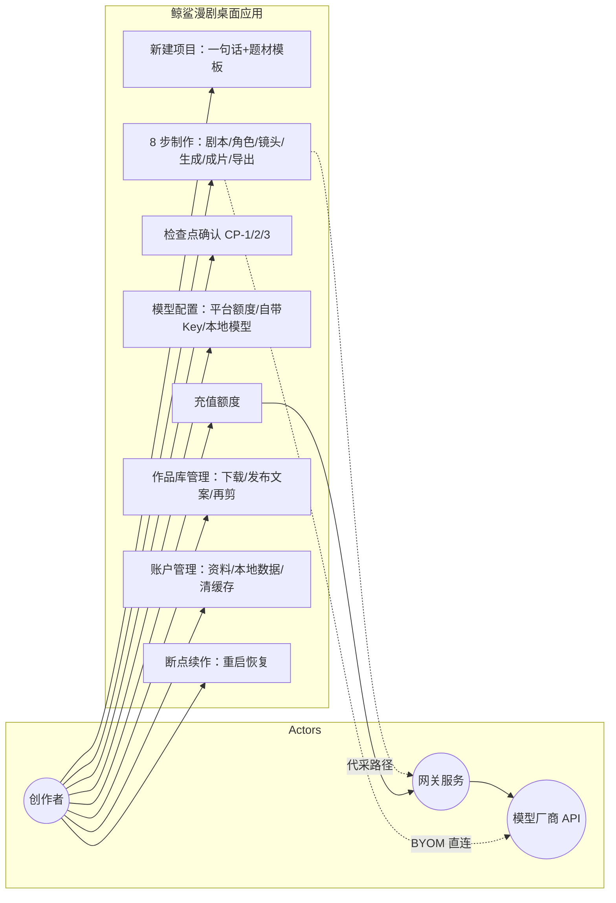
### 1.2 核心场景（按原型真实交互推导）
| # | 场景 | 主流程 | 关键非功能需求 |
|---|------|--------|----------------|
| S1 | 零基础首作 | 首页输入想法→模板填充→创建→8 步走完→作品库出现 3 集 | 全程不看说明书；每步 30 秒内可确认 |
| S2 | 双模式生成 | 关键镜头走可灵(BYOM)、过场走海螺(代采)，同一项目混用，账单分列 | 来源切换零迁移成本；路由理由可见 |
| S3 | 检查点止损 | CP-2 锁定前重 roll 免费；CP-3 样片不过→局部重拍 | 锁定后角色一致性强约束 |
| S4 | 断点续作 | 引擎/电脑重启→扫描挂起状态→恢复 resume_payload | 崩溃恢复是硬需求 |
| S5 | 充值回流 | 额度不足→弹窗三档套餐→支付→额度到账→继续生成 | 积分冻结/结算最终一致 |
| S6 | 合规导出 | 导出自动加 AI 标识+字幕→发布文案含声明 | Never 层红线拦截在先 |
---
## 2. 逻辑视图（Logical View）
### 2.1 分层架构
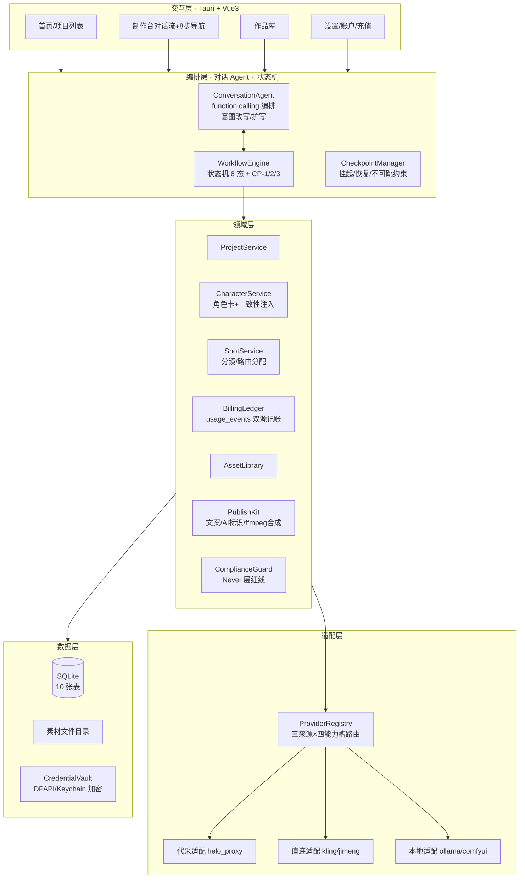
### 2.2 核心类图
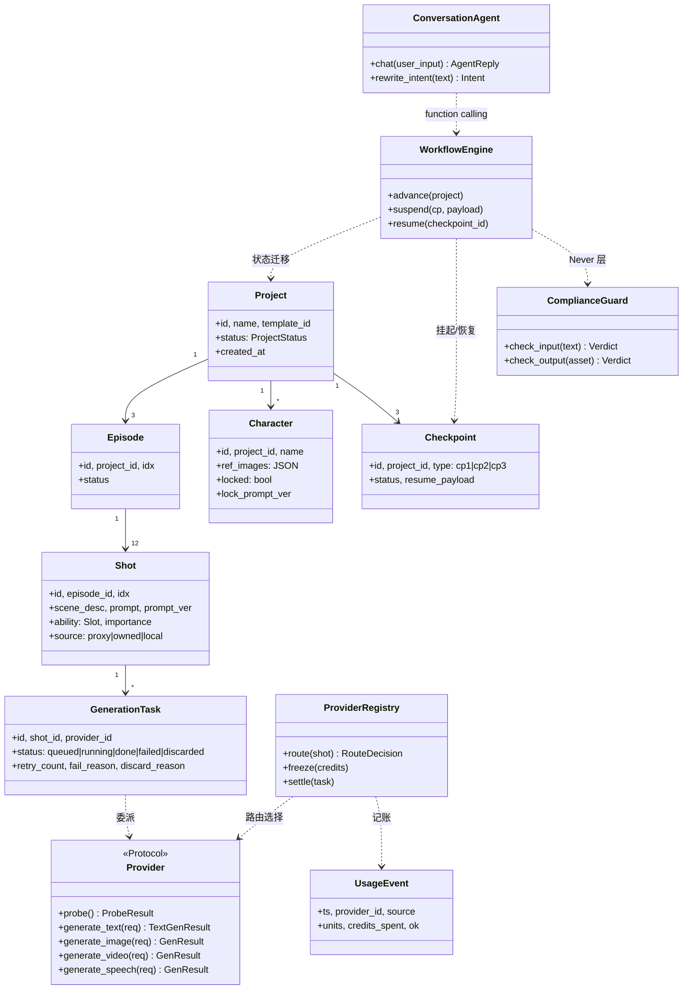
要点：
- **状态机是唯一事实源**：对话 Agent 只能通过 `WorkflowEngine` 的接口改变流程状态，不能绕过检查点约束（CP-2/CP-3 不可跳在引擎层强制，而非 UI 层）。
- **GenerationTask 是成片率统计的原子数据**：每个失败/废弃都带原因，喂给路由规则的持续优化（v0.5 差异化能力）。
- **Provider 是协议而非基类**：适配层可插拔，厂商 API 变化只影响单个 adapter 文件。
---
## 3. 过程视图（Process View）
### 3.1 运行时进程与并发模型
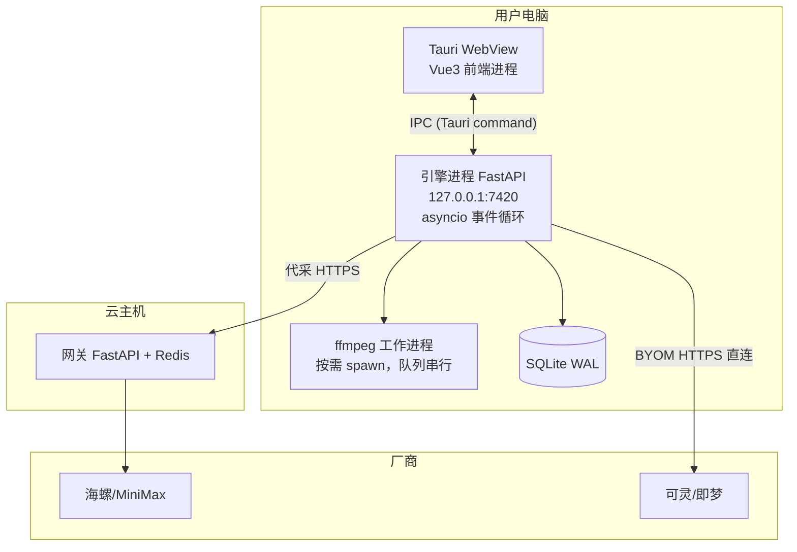
**并发设计（关键决策）**：
| 问题 | 方案 | 理由 |
|------|------|------|
| 本地引擎并发 | `asyncio` 单事件循环 + `asyncio.Semaphore` 按厂商分桶限流（如视频槽并发 ≤3，生图 ≤6） | 单用户桌面场景，无需多进程；信号量即可防厂商限频 |
| 视频异步任务 | 统一两段式 `submit → poll`，独立 poller 协程组，指数退避轮询 | 厂商普遍 1–10 分钟出片，不能阻塞事件循环 |
| 状态机与生成交错 | 生成任务只写 `generation_tasks`/`assets`，状态迁移由事件回调驱动，单写者（引擎）避免竞态 | SQLite 单写者模式天然免锁 |
| ffmpeg 合成 | `asyncio.create_subprocess` + 本地任务队列（合成耗 CPU，串行防卡死低配机） | 合成在导出时才发生，频率低 |
| 网关并发 | FastAPI + Redis：积分用 `DECRBY`/Lua 原子扣减，转发用 `httpx.AsyncClient` 连接池，按 uid 令牌桶限流 | 网关无重状态，单机 + Redis 足够支撑初期 |
### 3.2 关键时序 1：代采生成（冻结→结算）
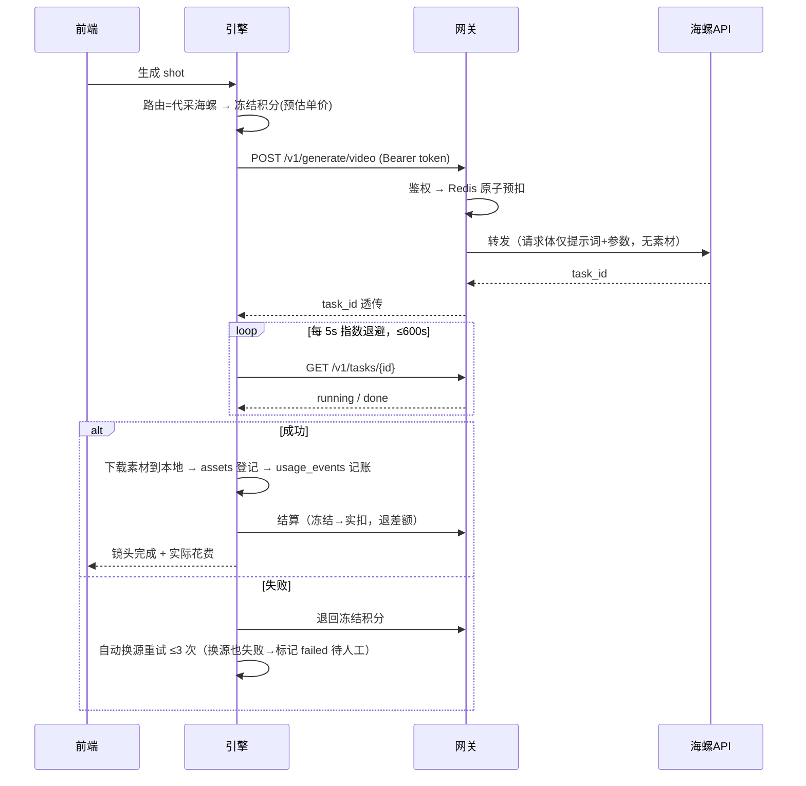
### 3.3 关键时序 2：检查点挂起与断点恢复
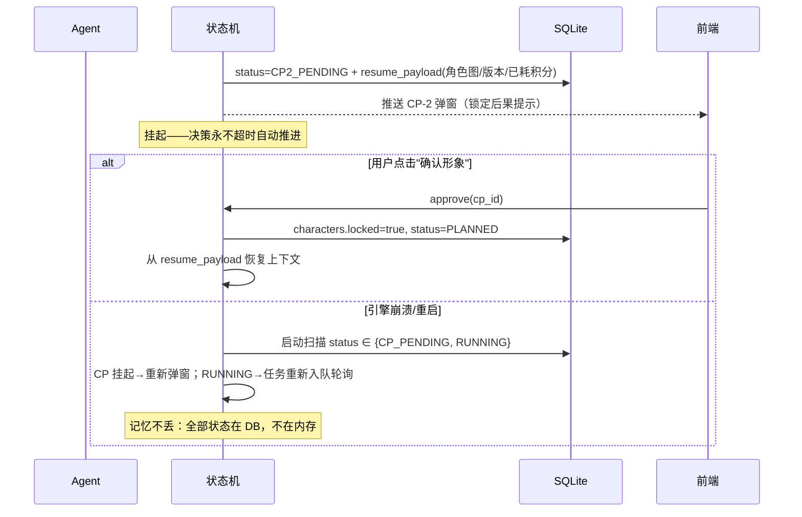
### 3.4 状态机全景（8 态 + 三检查点）
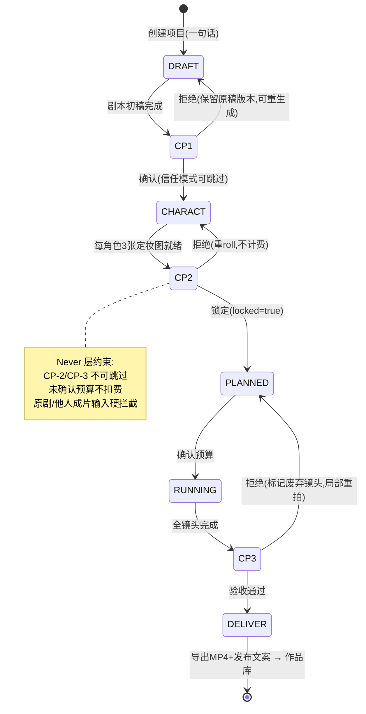
---
## 4. 开发视图（Implementation View）
### 4.1 仓库结构（继承 v1.0，标注新增）
```
mangju/
├── desktop/                  # Tauri 2 + Vue3（四视图：home/work/works/settings）
│   ├── src/views/            # ← 新增 works/（作品库）、account/（账户菜单）
│   ├── src/stores/           # Pinia：project/flow/billing/credits
│   └── src-tauri/            # sidecar 进程管理、文件对话框、凭证托管
├── engine/                   # Python FastAPI 本地引擎
│   └── app/
│       ├── agent/            # ★ 新增：ConversationAgent（意图改写/扩写、function calling）
│       ├── workflow/         # 状态机 + checkpoints + templates
│       ├── adapters/         # Provider 协议 + registry + 各厂商适配
│       ├── storage/          # SQLite(10表) + 素材索引
│       ├── billing/          # 双源记账（代采积分/BYOM估算）
│       ├── publish/          # ★ 新增：PublishKit（发布文案模板+AI标识+ffmpeg）
│       └── compliance/       # Never 层红线检查
├── gateway/                  # 云主机网关（鉴权/积分/转发/限流，无存储）
└── docs/                     # 设计文档系列（本文档为第 6 份）
```
### 4.2 模块依赖规则（自上而下，禁止反向）
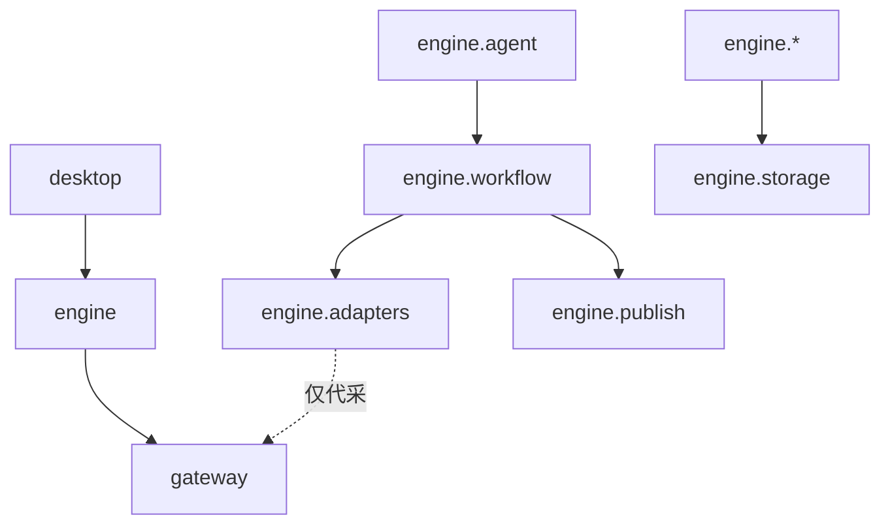
- 依赖方向单向：`desktop → engine → gateway`；`agent/workflow/publish` 只依赖 `adapters` 的协议接口，不 import 具体厂商适配。
- **单人可维护性检查**：任何模块单独可测（adapter 用录制回放、状态机用纯函数测试、UI 用组件快照）。
### 4.3 技术栈确认（不变项 + 增量项）
| 项 | 选型 | 变化 |
|----|------|------|
| 桌面壳 / 引擎 / 存储 | Tauri 2 + Vue3 / FastAPI sidecar / SQLite WAL | 不变 |
| 对话编排 | LLM function calling（DeepSeek/Qwen/Ollama） | 不变 |
| 视频合成 | ffmpeg（拼接/字幕/AI 标识水印） | 不变 |
| 发布文案 | 模板 + LLM 填充（PublishKit） | **新增** |
| 账户/充值 | 本地 CreditWallet 缓存 + 网关 Redis 记账 | **新增**（支付通道 V1 只接一个聚合支付） |
---
## 5. 物理视图（Physical / Deployment View）
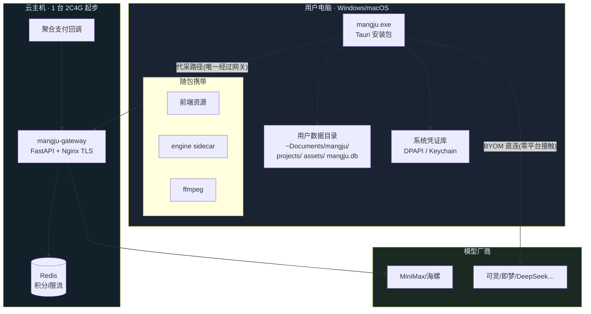
部署要点：
1. **网关是可选组件**：BYOM 用户全程不触网关；网关宕机仅影响代采路径，引擎降级提示而非崩溃。
2. **数据边界即信任边界**：素材/项目/密钥永不出用户电脑；网关侧每用户只有 Token、积分、脱敏用量记录。
3. 升级通道：Tauri 自更新（签名校验），引擎与前端同包发布；网关独立部署独立发版。
---
## 6. 九项 AI 工程技术评估（核心决策章节）
> 评估原则：每项技术必须回答"解决本产品的哪个真实问题"——没有对应问题的技术一律不引入。
### 6.1 决策总表
| # | 技术 | 结论 | 一句话理由 |
|---|------|------|-----------|
| 1 | 数据完整 / 用户隔离 | ✅ **采用（架构级）** | 单机架构天然隔离；网关侧做账户级隔离即可 |
| 2 | 高并发 | ✅ **局部采用** | 引擎内信号量限流 + 网关 Redis 原子计费；不做分布式 |
| 3 | 评估 + Multi-Agent 交叉验证 | ⚠️ **简化采用** | 双模型交叉审校剧本 + 定妆图自动打分；拒绝网状 Multi-Agent |
| 4 | 记忆断层 | ✅ **采用（状态机方案）** | 断点续作=持久化记忆；长期记忆用结构化角色卡，不用向量库 |
| 5 | RAG 多链路/关联召回 | ⏸️ **V2 采用** | V1 模板库小用结构化过滤；V2 提示词模式库再上混合检索+元数据 |
| 6 | 图片/表格/公式识别提取 | ❌ **基本不采用** | 漫剧非文档场景；仅保留 VLM 图转提示词一个子能力 |
| 7 | 问题重写和扩写 | ✅ **采用** | 对话 Agent 的核心职责，成本几乎为零 |
| 8 | 评估 + 细粒度 Reranker | ⚠️ **轻量采用** | 定妆图多候选用规则+VLM 一致性打分排序；不部署独立 Reranker 服务 |
| 9 | Attention 推理优化 | ❌ **不采用** | 不训练不部署推理；推理全在厂商侧或用户本地 Ollama |
### 6.2 逐项设计说明
#### ① 数据完整、用户隔离 — 采用（本文档多处已落地）
- **桌面侧**：天然物理隔离——每用户一套 SQLite + 素材目录，无共享存储，无越权可能。
- **网关侧**（唯一多用户面）：
  - 隔离单元 = `uid`（Token → uid → 独立积分账户），Redis 键名强制 `credits:{uid}:*`，限流桶按 uid；
  - 完整性：积分变动走 Lua 原子脚本（校验+扣减一步完成），每次变更有流水（`ledger:{uid}`），日终对账 `Σ流水 == 余额`；
  - 网关不留存提示词全文（哈希留痕）、不落任何素材——数据完整性责任边界清晰：**用户数据在用户机器，计费数据在网关**。
#### ② 高并发 — 局部采用（过程视图 3.1 已给出全量方案）
补充判断依据：真实负载画像 = **单用户桌面（引擎并发 = 厂商限频上限，≤6）** + **网关初期日活 <500（单机 FastAPI + Redis 余量 10 倍以上）**。引入消息队列/微服务是负资产。唯一要做的"并发正确性"是：
- 引擎侧：信号量分桶 + 退避重试 + 换源重试（≤3）；
- 网关侧：积分原子扣减防超卖（并发同一 uid 快速连点）；
- 压测验收：`locust` 模拟 200 并发 uid × 代采请求，零超卖、P95 < 800ms（转发耗时除外）。
#### ③ Multi-Agent 交叉验证 — 简化采用（"审校员"模式，不搞 Agent 编队）
**要解决的问题**：LLM 单次生成剧本有逻辑漏洞/价值观风险；定妆图 3 选 1 用户不懂判。
```mermaid
flowchart LR
    A[主生成Agent<br/>DeepSeek/Qwen] -->|剧本初稿| R[审校Agent<br/>换一家模型交叉读]
    R -->|问题清单+风险标注| UI[CP-1 弹窗呈现给用户]
    A -->|每角色3张候选| V[一致性打分器<br/>规则(VLM)排序]
    V -->|排序+理由| UI2[CP-2 呈现推荐序]
```
- 实现成本：第二个模型 = 用户已有的另一槽位模型，零新增基础设施；提示词各一份。
- 明确不做：规划-执行-反思的网状 Multi-Agent、Agent 间自由通信——流程本身已由状态机约束，多 Agent 自由度只会放大不可控性。
#### ④ 记忆断层 — 采用（状态机 + 结构化长期记忆）
"记忆断层"在本产品具体化为三个场景，逐一解决：
| 断层场景 | 方案 |
|---|---|
| 会话中断（重启/崩溃） | resume_payload 持久化 + 启动扫描恢复（见 3.3 时序）——**记忆即数据库，不在内存** |
| 对话上下文超窗口 | 状态摘要压缩：Agent 每步把"已决策事实"写入结构化字段（角色卡/镜头表），对话历史只留近 N 轮 + 摘要头 |
| 跨项目经验（V2） | 成功提示词模式沉淀为模板库条目（结构化 + 元数据），非自由文本向量记忆 |
角色卡是"长期记忆"的正确形态：`{外貌描述, 定妆图ref, 锁定版本, 注入提示词模板}`——一致性靠**注入**而非靠模型"记住"。
#### ⑤ RAG 多链路召回 / 关联召回（元数据） — V2 采用，V1 结构化过滤
V1 判断依据：题材模板 3 个、流程模板 1 个——**数据量不到检索阈值**，SQL `WHERE genre=? AND type=?` 就是全部"召回"。
V2 触发条件（满足其一才立项）：提示词模式库 >1k 条；接入网文 IP 拆解（章节数十万字）。届时方案：
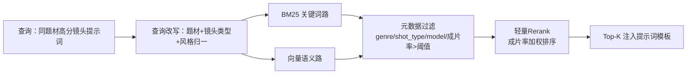
- 多链路 = BM25 + 向量双路合并（Reciprocal Rank Fusion，无需训练）；
- 关联召回靠**元数据血缘**：每条提示词带 `model_id / shot_type / 成片率 / 失败原因聚类`，召回天然联动成片率统计——这是本产品 RAG 与通用 RAG 的差异化：**检索目标不是文档相似度，是"可复用的成功经验"**。
#### ⑥ 图片/表格/公式识别提取 — 基本不采用
- 漫剧生产链路无表格/公式场景（对比财务工具项目才有此需求）。
- 唯一保留子能力：**图转提示词**（用户上传参考图→VLM 反推画面描述→注入定妆提示词），用厂商多模态 API 即可，不自建识别管线。
- 结论：该技术与本业务正交，引入即纯成本。
#### ⑦ 问题的重写和扩写 — 采用（对话 Agent 内置）
用户原话是"第二集太快了""主角不够惨"——不可直接执行。Agent 的改写管线：
```
用户口语 → 意图分类(改剧本/改镜头/改角色/询问) → 参数化改写
  "第二集太快了" → {scope: episode_2, op: pacing_expand, 建议: 在站台戏前增加1个铺垫镜头, cost_impact: +9额度}
改写结果必须回显（"你是要……吗？"二次确认），影响预算的必须展示成本变化——重写不仅是语义问题，是信任问题。
```
#### ⑧ 评估 + 细粒度 Reranker — 轻量采用
两个真实排序需求，均不部署独立 Reranker 服务：
1. **定妆图 3 选 1**：规则分（与角色文字描述的要素命中）+ VLM 打分（一致性/画质）加权，输出推荐序展示给用户，**用户永远保留最终选择权**；
2. **废片归因**：失败任务按 `fail_reason` 聚类 → 反哺路由规则（哪类镜头换哪家模型通过率高）——评估的对象不是"文档相关性"，是"生成成功率"，这是本产品评估体系的独特重心。
#### ⑨ Attention 推理优化 — 不采用
- 产品定位（v0.4 定案）：**纯流程编排，不训练、不部署自有推理**。推理发生在厂商 API 或用户本地 Ollama/ComfyUI——后者是我们适配的"外置能力"，其优化是 Ollama 生态的事。
- 唯一沾边的优化是**调用层**的：提示词压缩（减少 token）、失败重试策略（减少无效调用）、成片率提升（减少总调用次数）——全部属于编排层手段，与 Attention 内核优化无关。
- 若未来自建本地推理服务（概率极低），届时再议 KV-Cache/量化/投机解码，且应作为独立基础设施项目评估。
### 6.3 技术引入时间线（与里程碑对齐）
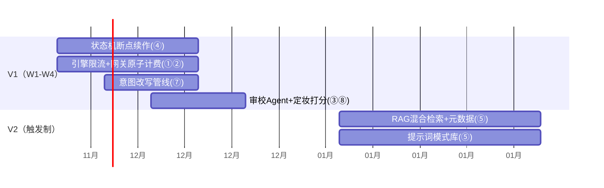
---
## 7. 质量属性与验证清单
| 质量属性 | 验收标准 | 验证方式 |
|---|---|---|
| 可恢复性 | 引擎任意时刻 kill -9，重启后 100% 断点恢复 | 混沌测试脚本（W3 里程碑） |
| 数据隔离 | 网关渗透测试：Token A 无法读写 B 的积分/用量 | 自动化用例 |
| 计费正确性 | 200 并发下单零超卖；失败任务积分 100% 退回 | locust + 对账脚本 |
| 一致性 | CP-2 锁定后 12 镜头角色图 100% 同源 | 端到端断言 |
| 可维护性 | 适配一个新厂商 ≤1 人日（只新增 1 个 adapter 文件） | W2 用可灵实测计时 |
| 合规 | 原剧输入 100% 拦截；导出成片 100% 带 AI 标识 | Never 层单测覆盖 |
---
## 8. 与既有文档的关系
```
v0.3 Agent交互方案 ─┐
v0.4 BYOM架构     ─┼→ v1.0 技术概要设计 ─→ 本文 v2.0（4+1 视图 + 9 项技术决策）
v0.5 双模式供给    ─┘                         │
                                              └→ 下游：详细设计（接口字段级）→ 代码实现
```
本文档冻结后即可启动 W1 编码；9 项技术中 4 项"采用/简化采用"已全部映射到 V1 里程碑任务，无悬空决策。
---
*文档版本：v2.0 · 2026-11-18 · 依据原型 v2.0（70 处交互）与设计文档 v0.3–v1.0 演进*
