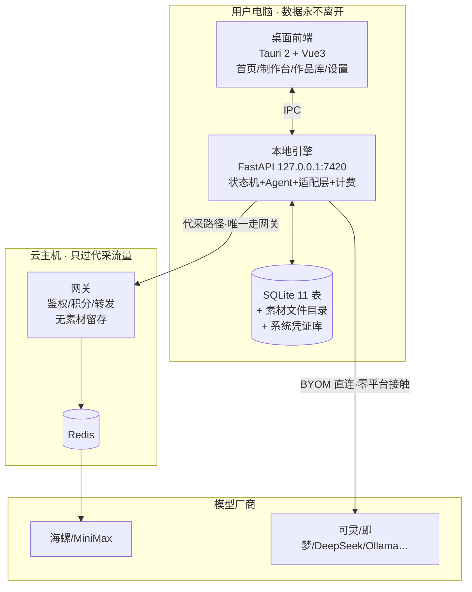
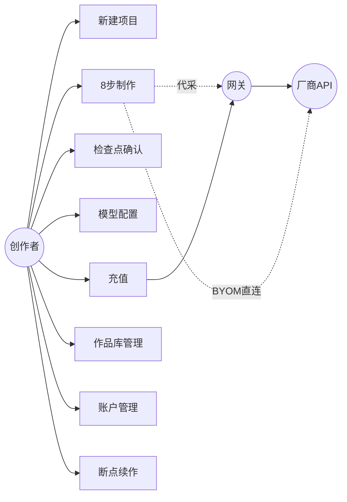
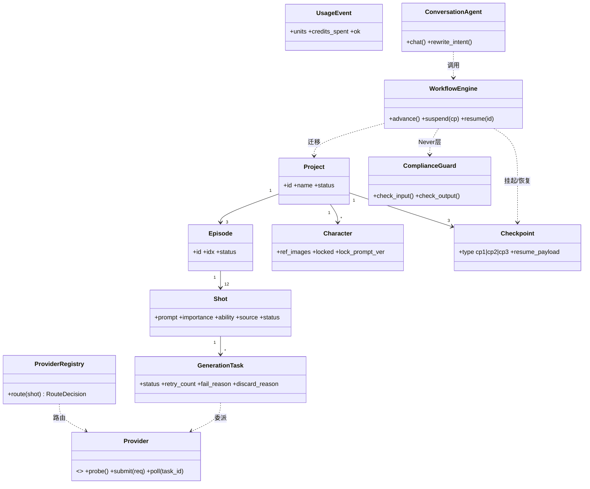
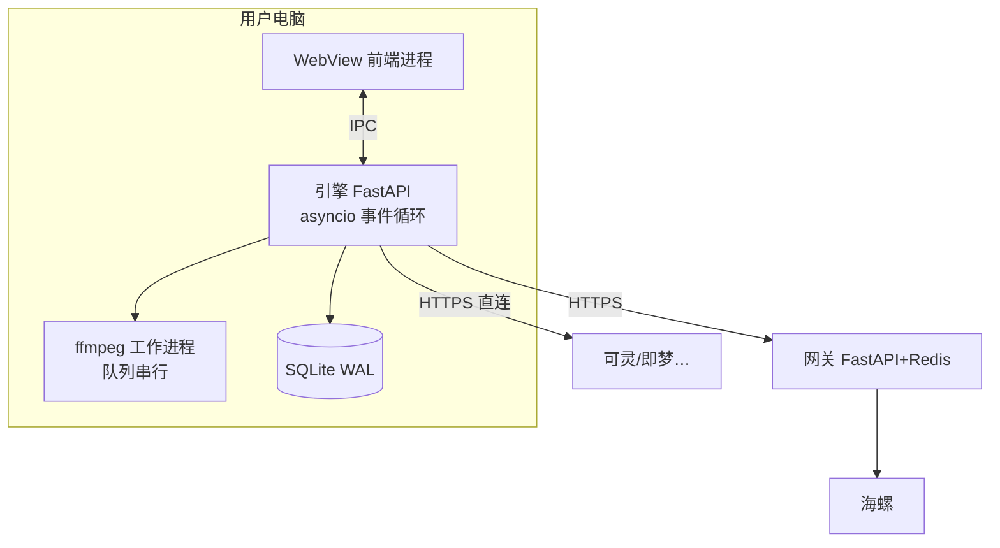
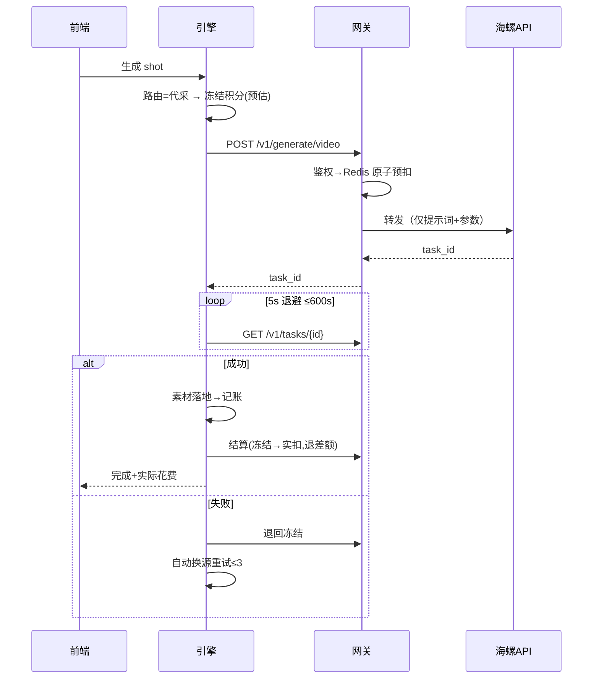
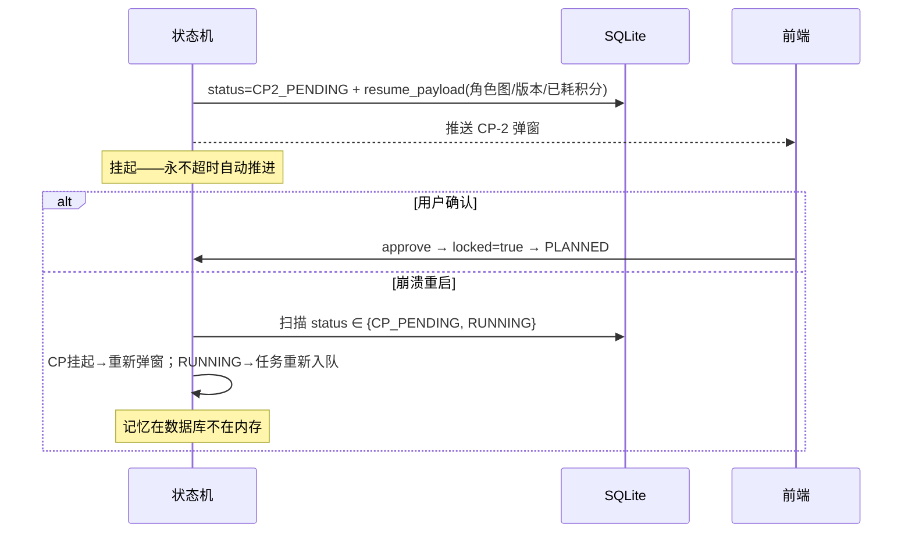
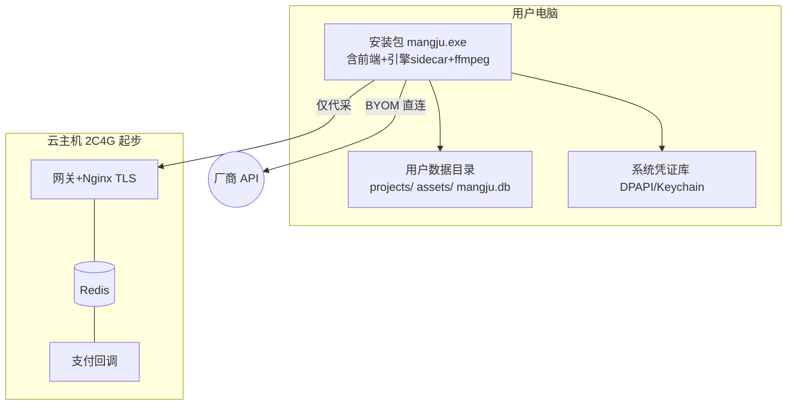
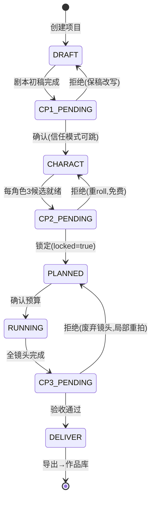

# 鲸鲨漫剧 系统设计方案（架构 + 详细设计 合订本）v3.0
> **本文自包含**：从产品定位到字段级接口一次读完，不依赖任何外部文档。
> 阅读路径：第 1 章 5 分钟看懂全貌 → 第 2-8 章按需深读。
> 版本：v3.0 · 2026-11-18
---
## 1. 一页看懂
### 1.1 产品是什么
**鲸鲨漫剧**是一个**本地优先的 AI 漫剧制片桌面应用**：创作者用一句话想法起步，Agent 按 8 步流程（写剧本→确认剧本→角色形象→锁定形象→拆分镜头→生成画面→看成片→导出视频）带其走完从想法到成片的全过程。
- **目标用户**：注册过即梦/可灵等模型账号、但没独立做出过完整连贯短剧的创作者（十万级沉默大多数）
- **核心买点**：① 数据不出电脑 ② 双模式模型供给（平台代采额度 + 自带 API 密钥 + 本地模型）③ 三检查点止损（防换脸返工/整集报废）④ 成本账本与成片率统计
- **商业模式**：软件订阅（免费版/专业版）+ 代采额度差价（10-15%）
### 1.2 架构一张图

**三条铁律**（贯穿全部设计）：
1. 单机可完整运行——网关宕机，自带密钥用户零影响
2. 密钥与素材只存本地——SQLite 里的凭证是密文，网关不留提示词全文与任何素材
3. 只做流程编排——不训练模型、不部署自有推理
### 1.3 技术决策一表（9 项 AI 工程技术）
| # | 技术 | 决策 | 一句话理由 |
|---|------|------|-----------|
| 1 | 用户数据隔离 | ✅ 架构级采用 | 单机物理隔离；网关按 uid 隔离积分与限流 |
| 2 | 高并发 | ✅ 局部采用 | 引擎信号量限流 + 网关 Redis 原子计费；不上消息队列 |
| 3 | Multi-Agent 交叉验证 | ⚠️ 简化采用 | 双模型"审校员"模式；拒绝网状 Agent 编队 |
| 4 | 记忆断层 | ✅ 采用 | 状态持久化 + 结构化角色卡；不用向量库 |
| 5 | RAG 多链路/关联召回 | ⏸ V2 再上 | V1 数据量未达检索阈值，SQL 过滤即可；V2 方案已备（§8.5） |
| 6 | 图片/表格/公式识别 | ❌ 不采用 | 漫剧非文档场景，仅保留 VLM 图转提示词 |
| 7 | 问题重写与扩写 | ✅ 采用 | 对话 Agent 核心职责，带成本影响回显 |
| 8 | 评估 + 细粒度 Reranker | ⚠️ 轻量采用 | 定妆候选规则+VLM 打分排序；不部署独立服务 |
| 9 | Attention 推理优化 | ❌ 不采用 | 不训练不部署推理；优化责任在厂商侧 |
---
## 2. 产品需求与场景
### 2.1 功能范围（四视图，与原型一一对应）
| 模块 | 功能 | 关键交互 |
|---|---|---|
| 首页 | 一句话建项 / 题材模板填充 / 项目列表（进行中+已完成） | create / fillTpl / openProject |
| 制作台 | 8 步流程 + 三检查点 + 分镜表 + 角色卡 + 账单分列 + 对话修改 | goto / regen / confirm / lock / gen / play / export |
| 作品库 | 成片列表 / 下载 / 发布文案（含 AI 声明）/ 再剪一版 | download / copyCap / reedit |
| 设置 | 三来源×四能力槽配置 / 连接测试 / 充值 / 账户菜单 | pickModel / testKey / recharge / um* |
### 2.2 核心场景
| # | 场景 | 主流程 | 非功能要求 |
|---|------|--------|-----------|
| S1 | 零基础首作 | 一句话→模板→8 步→作品库出 3 集 | 全程不看说明书；检查点 30 秒内可确认 |
| S2 | 双模式生成 | 关键镜头走可灵(自带)、过场走海螺(代采)，账单分列 | 路由理由必须可见 |
| S3 | 检查点止损 | CP-2 锁定前重 roll 免费；CP-3 不过→局部重拍 | 锁定后角色一致性强约束 |
| S4 | 断点续作 | 崩溃/重启→扫描挂起状态→恢复现场 | 100% 恢复（混沌测试验收） |
| S5 | 充值回流 | 额度不足→套餐弹窗→支付→到账→继续 | 冻结/结算最终一致、零超卖 |
| S6 | 合规导出 | 自动 AI 标识+字幕+发布文案声明 | Never 层红线先拦截 |
### 2.3 用例图

---
## 3. 总体架构（4+1 视图）
### 3.1 逻辑视图：五层架构与核心类
```mermaid
flowchart TB
    subgraph L1[交互层 · Tauri+Vue3]
        UI[首页 / 制作台(对话+8步) / 作品库 / 设置]
    end
    subgraph L2[编排层]
        AGENT[ConversationAgent<br/>意图改写+function calling]
        FSM[WorkflowEngine 状态机<br/>8态+CP1/2/3]
    end
    subgraph L3[领域层]
        SVC[项目 / 角色 / 分镜 / 计费账本 / 资产库 / 发布套件 / 合规守卫]
    end
    subgraph L4[适配层]
        REG[ProviderRegistry<br/>三来源×四能力槽路由]
        AD[代采helo / 直连kling·jimeng / 本地ollama·comfyui]
    end
    subgraph L5[数据层]
        D[(SQLite)] --- F[素材文件] --- K[凭证加密库]
    end
    UI --> L2 --> SVC --> REG --> AD
    SVC --> L5
```

**设计要点**：
- **状态机是唯一事实源**：Agent 只能经 `WorkflowEngine` 改流程状态，检查点不可跳在引擎层强制（UI 无跳过按钮是双保险）
- **GenerationTask 是成片率的原子数据**：每次失败/废弃带原因，反哺路由规则
- **Provider 是协议**：换厂商只改一个 adapter 文件（验收：新厂商接入 ≤1 人日）
### 3.2 过程视图：进程、并发与时序
**运行时进程**：

**并发设计**：
| 问题 | 方案 |
|---|---|
| 引擎并发 | asyncio + 信号量分桶：video≤3、image≤6、speech≤4、text≤2；同厂商并发≤2 防限频连坐 |
| 视频异步 | 统一两段式 submit→poll，独立 poller 协程，5s 起指数退避，≤600s |
| 状态与生成交错 | 生成只写 tasks/assets 表，状态迁移由事件回调驱动；SQLite 单写者免锁 |
| ffmpeg 合成 | 子进程 + 串行队列（防低配机卡死） |
| 网关并发 | Redis 令牌桶按 uid 限流（10/s）；积分 Lua 原子扣减防超卖 |
**时序 1：代采生成（冻结→结算）**

**时序 2：检查点挂起与崩溃恢复**

### 3.3 开发视图：仓库与依赖
```
mangju/
├── desktop/              # Tauri 2 + Vue3（src/views: home/work/works/settings）
│   └── src-tauri/        # sidecar 管理、文件对话框、凭证托管
├── engine/app/           # Python FastAPI
│   ├── agent/            # ConversationAgent（工具白名单+意图改写）
│   ├── workflow/         # 状态机 + checkpoints + templates
│   ├── adapters/         # base.py 协议 / registry / helo_proxy / kling_direct / ollama…
│   ├── storage/          # SQLite 11 表 + 素材索引
│   ├── billing/          # 双源记账（代采积分/BYOM估算）
│   ├── publish/          # 发布文案+AI标识+ffmpeg
│   └── compliance/       # Never 层
├── gateway/              # FastAPI+Redis（鉴权/积分/转发/限流，无存储）
└── docs/
```
依赖单向：`desktop → engine → gateway`；`agent/workflow/publish` 只依赖 adapters 协议接口，不 import 具体厂商实现。每个模块单独可测（adapter 录制回放、状态机纯函数、UI 组件快照）。
### 3.4 物理视图：部署

- 网关是**可选组件**：仅代采路径经过；宕机时引擎降级提示，不崩溃
- 数据边界即信任边界：用户机器存项目/素材/密钥；网关只存 Token/积分/脱敏用量
- 升级：Tauri 签名自更新，引擎与前端同包；网关独立发版
---
## 4. 数据库设计（SQLite DDL）
> 引擎为唯一写者；WAL 模式；所有表由触发器维护 created_at/updated_at（下略）。
```sql
PRAGMA journal_mode=WAL; PRAGMA foreign_keys=ON;
CREATE TABLE projects (
  id TEXT PRIMARY KEY,                -- ULID
  name TEXT NOT NULL,
  template_id TEXT NOT NULL,          -- 'life_3ep'
  idea_text TEXT NOT NULL,            -- 用户原始一句话
  status TEXT NOT NULL,               -- §5.1 状态枚举
  deleted_at TEXT                     -- 软删（回收站 7 天）
);
CREATE TABLE episodes (
  id TEXT PRIMARY KEY,
  project_id TEXT NOT NULL REFERENCES projects(id),
  idx INTEGER NOT NULL,               -- 1..3
  status TEXT NOT NULL DEFAULT 'pending',  -- pending|scripted|generated|exported
  UNIQUE(project_id, idx)
);
CREATE TABLE characters (
  id TEXT PRIMARY KEY,
  project_id TEXT NOT NULL REFERENCES projects(id),
  name TEXT NOT NULL,
  desc_text TEXT NOT NULL,            -- 外貌文字描述（一致性锚点）
  ref_images TEXT NOT NULL,           -- JSON: [{asset_id, score, rank}]
  locked INTEGER NOT NULL DEFAULT 0,
  lock_prompt_ver INTEGER,            -- 锁定时的提示词版本
  CHECK (locked IN (0,1))
);
CREATE TABLE shots (
  id TEXT PRIMARY KEY,
  episode_id TEXT NOT NULL REFERENCES episodes(id),
  idx INTEGER NOT NULL,
  scene_desc TEXT NOT NULL,
  prompt TEXT NOT NULL,
  prompt_ver INTEGER NOT NULL DEFAULT 1,
  importance TEXT NOT NULL,           -- key|transition
  ability TEXT NOT NULL,              -- text|image|video|speech
  source TEXT NOT NULL,               -- proxy|owned|local
  provider_id TEXT,                   -- 运行时由路由写入
  status TEXT NOT NULL DEFAULT 'planned'
);
CREATE TABLE generation_tasks (
  id TEXT PRIMARY KEY,
  shot_id TEXT NOT NULL REFERENCES shots(id),
  provider_id TEXT NOT NULL,
  request_hash TEXT NOT NULL,         -- 幂等键：同 shot+prompt_ver+provider 只跑一次
  status TEXT NOT NULL,               -- queued|running|done|failed|discarded
  retry_count INTEGER NOT NULL DEFAULT 0,
  fail_reason TEXT,                   -- timeout|rate_limit|content_blocked|provider_error|unknown
  discard_reason TEXT,                -- cp3_rejected|user_discard
  provider_task_id TEXT,             -- 厂商异步任务号
  UNIQUE(shot_id, request_hash)
);
CREATE INDEX idx_tasks_status ON generation_tasks(status);
CREATE TABLE assets (
  id TEXT PRIMARY KEY,
  project_id TEXT NOT NULL REFERENCES projects(id),
  kind TEXT NOT NULL,                 -- image|video|audio|script|work
  local_path TEXT NOT NULL,           -- 相对用户数据目录
  sha256 TEXT NOT NULL,
  shot_id TEXT REFERENCES shots(id),
  character_id TEXT REFERENCES characters(id),
  size_bytes INTEGER NOT NULL
);
CREATE TABLE checkpoints (
  id TEXT PRIMARY KEY,
  project_id TEXT NOT NULL REFERENCES projects(id),
  type TEXT NOT NULL,                 -- cp1|cp2|cp3
  status TEXT NOT NULL,               -- pending|approved|rejected
  resume_payload TEXT NOT NULL,       -- JSON 快照：角色图/已耗积分/版本
  decided_at TEXT
);
CREATE TABLE usage_events (           -- 双源记账，成片率统计源
  id TEXT PRIMARY KEY,
  ts TEXT NOT NULL,
  project_id TEXT,
  provider_id TEXT NOT NULL,
  source TEXT NOT NULL,               -- proxy|owned|local
  ability TEXT NOT NULL,
  units REAL NOT NULL,
  credits_spent REAL NOT NULL DEFAULT 0,   -- BYOM=0
  raw_cost_estimate REAL NOT NULL DEFAULT 0,
  ok INTEGER NOT NULL,
  fail_reason TEXT
);
CREATE INDEX idx_usage_ts ON usage_events(ts);
CREATE TABLE model_configs (
  id TEXT PRIMARY KEY,
  slot TEXT NOT NULL,                 -- text|image|video|speech
  source TEXT NOT NULL,               -- proxy|owned|local
  provider_kind TEXT NOT NULL,        -- openai_compat|kling|jimeng|helo|ollama|comfyui
  name TEXT NOT NULL,
  endpoint TEXT,
  credential_cipher BLOB,             -- AES-256-GCM 密文，永无明文
  abilities TEXT NOT NULL,            -- JSON
  is_active INTEGER NOT NULL DEFAULT 1
);
CREATE TABLE credit_wallet (
  id INTEGER PRIMARY KEY CHECK (id=1),-- 单行表
  balance REAL NOT NULL DEFAULT 0,    -- 本地缓存，网关为准
  frozen REAL NOT NULL DEFAULT 0,
  synced_at TEXT
);
CREATE TABLE agent_history (          -- 对话记忆
  id TEXT PRIMARY KEY,
  project_id TEXT,
  role TEXT NOT NULL,                 -- user|agent|system
  content TEXT NOT NULL,
  intent_json TEXT,                   -- 结构化意图（改写产物）
  summary_to TEXT                     -- 此行之前的历史已压缩进该行
);
```
**凭证规则**：主密钥存 OS 凭证库（Windows DPAPI / macOS Keychain，键 `mangju.engine.master`），`credential_cipher` 为 AES-256-GCM 密文——数据库文件被拷走也无法解密。
---
## 5. 核心机制详细设计
### 5.1 状态机（8 态 + 三检查点）

**完整迁移表**：
| 当前态 | 事件 | 守卫 | 动作 | 次态 |
|---|---|---|---|---|
| DRAFT | script_ready | — | 生成大纲+看点标签 | CP1_PENDING |
| CP1_PENDING | approve | — | 版本定稿 | CHARACT |
| CP1_PENDING | approve | trust_mode | 仍记录 checkpoints 行 | CHARACT |
| CP1_PENDING | reject | — | 保留原稿，prompt_ver++ | DRAFT |
| CHARACT | roles_ready | 每角色≥1 候选 | 打分排序 | CP2_PENDING |
| CP2_PENDING | approve | sel≥1 | locked=1，写 lock_prompt_ver | PLANNED |
| CP2_PENDING | reject | — | 重 roll（不扣费） | CHARACT |
| PLANNED | budget_confirmed | est ≤ 可用额度 | 路由快照入 shots | RUNNING |
| PLANNED | budget_confirmed | 额度不足 | 返回 E2001，触发充值引导 | PLANNED |
| RUNNING | all_done | — | 合成 30s 样片 | CP3_PENDING |
| RUNNING | task_failed | 重试耗尽 | 标记 failed，继续其余镜头 | RUNNING |
| CP3_PENDING | approve | — | 全量合成入队 | DELIVER |
| CP3_PENDING | reject | — | discard_reason=cp3_rejected | PLANNED |
| DELIVER | export_done | — | 写 works+文案缓存 | 终态 |
**崩溃恢复**（启动扫描）：CP 挂起→重读 resume_payload 重新弹窗（不自动推进）；RUNNING→未完成任务重新入队（provider_task_id 在则续轮询，丢失则重 submit）；导出中断→幂等重跑（sha256 相同复用产物）。
### 5.2 模型适配层
**统一协议（伪异步，上层只见一种两段式）**：
```python
@dataclass
class TextGenRequest:  prompt: str; system: str; max_tokens: int; temperature: float
@dataclass
class ImageGenRequest: prompt: str; ref_image_asset: str | None; size: str
@dataclass
class VideoGenRequest: prompt: str; first_frame_asset: str | None; duration_s: int; ratio: str
@dataclass
class SpeechRequest:   text: str; voice_id: str; speed: float
@dataclass
class GenResult:
    ok: bool; asset_ref: str | None; units_used: float
    raw_cost_estimate: float; fail_reason: str | None; provider_task_id: str | None
class Provider(Protocol):
    meta: ProviderMeta       # id/kind/source/abilities/单价提示
    async def probe(self) -> ProbeResult           # 10s 超时连接测试
    async def submit(self, req) -> str             # 文本/生图内部即完成
    async def poll(self, task_id) -> GenResult
```
**路由规则（可解释，reason 必须给用户看）**：
| 槽 | 默认路由 | 换源重试 |
|---|---|---|
| text | 自带(OpenAI兼容)→本地(Ollama)→提示配置（不代采） | 不重试 |
| image | 自带即梦→代采海螺池 | ≤1 次 |
| video | 关键镜头→可灵(自带优先)；过场→海螺(代采)；通过率差>15% 反转 | ≤3 次（timeout/rate_limit 才换） |
| speech | 本地 edge-tts(免费)→代采 MiniMax | ≤1 次 |
重试策略：`fail_reason ∈ {timeout, rate_limit, provider_error}` 才换源；`content_blocked` 不重试，联动合规提示改词。
### 5.3 对话 Agent（安全边界 + 意图改写 + 记忆）
**工具白名单（全量 7 个，代码即 Never 层）**：
| 工具 | 作用 |
|---|---|
| get_script / get_shots / get_characters | 只读查询 |
| regen_script(note) | 重写剧本 |
| adjust_pacing(episode_idx, op, insert_count?) | 节奏调整（回显 cost_impact） |
| swap_role_image(role_id) | 单角色重 roll |
| answer_question(text) | 纯回复不动状态 |
| route_to_recharge / route_to_settings | 页面跳转 |
**没有 approve_checkpoint、没有任何扣费工具**——检查点与预算确认只能用户在 UI 点击，Agent 在代码结构上不可能越权。
**意图改写管线**：用户口语（"第二集太快了"）→ 分类{剧本/镜头/角色/账户/闲聊} → 改写为 `{op: pacing_expand, scope: episode_2, cost_impact: +9额度}` → SSE 回显确认 → 确认后才执行。未确认的写操作一律拒绝。
**记忆管理**：短期=最近 20 轮原文；超过后旧对话 LLM 压缩为 ≤200 字摘要（summary_to 标记）；**事实记忆不进对话**——角色/镜头/版本/花费全在结构化表，Agent 按需查询，杜绝"聊着聊着忘了主角长相"。
### 5.4 计费账本
- **双源记账**：代采记 `credits_spent`（网关结算为准）；BYOM 记 `credits_spent=0` + `raw_cost_estimate`（公开单价估算）——成片率统计两种来源都有数据
- **冻结→结算**：提交前按预估冻结；完成实扣退差额；失败全额退回
- **对账**：网关每日 cron 校验 `Σ(ledger)==余额`，不平即冻结该 uid 代采（BYOM 不受影响）
### 5.5 合规 Never 层（规则表）
| 检查点 | 规则 | 处置 |
|---|---|---|
| 输入 | 上传视频/他人成片（扩展名+时长+来源声明判定） | 拒绝+引导合法替代（授权网文/原创） |
| 输入 | 剧本命中红线词库（涉政/低俗/侵权） | 高危拒绝生成；中危标注供 CP-1 展示 |
| 生成 | 厂商返回 content_blocked | 不重试，给改写方向 |
| 导出 | ai_badge 恒 true（API 忽略 false） | ffmpeg 烧录 AI 标识 |
| 发布 | 文案强制含 AI 生成声明 | 声明段模板锁定，LLM 只填正文 |
---
## 6. 接口设计
### 6.1 引擎 REST API（前端↔引擎，`127.0.0.1:7420/api`）
通用约定：启动时引擎生成随机 token（Tauri 安全存储），防本机其他进程调用；时间 ISO 8601；错误信封 `{"error":{"code":"E2001","message":"中文白话"}}`（错误码见 §8.2）。
```
── 项目与首页 ──
POST /api/projects            {idea, template_id} → {id, name, status, next_action}
GET  /api/projects?status=active → 项目列表(含 step_index/step_total)
GET  /api/projects/{id}       → 详情+current_step+resume_hint+credits_frozen
DELETE /api/projects/{id}     → 软删（回收站 7 天）
── 制作流程 ──
POST /api/projects/{id}/steps/{step}/advance
     {action: approve|reject, payload} → {project_status, effects}
POST /api/projects/{id}/regen
     {target: script|roles|role_image, role_id?} → {task_id, free}
GET  /api/projects/{id}/script?ver=      # 稿号=版本
GET  /api/projects/{id}/outline
GET  /api/projects/{id}/characters       # 候选图+打分排序
GET  /api/projects/{id}/shots            # 分镜表+路由reason+est_cost
POST /api/projects/{id}/generation/start → {batch_id, queued}
POST /api/projects/{id}/generation/pause
GET  /api/projects/{id}/generation/progress → {done,total,running,failed,failed_items}
GET  /api/projects/{id}/preview          # 30s 样片(低码率)
POST /api/projects/{id}/export           {ratio, with_subtitle, ai_badge:true}
GET  /api/exports/{task_id}              # {state, pct} | {state:done, work_id}
── 作品库 ──
GET  /api/works                          # 成片列表(时长/大小/ai_badged)
GET  /api/works/{id}/caption             # 发布文案(LLM生成后缓存)
POST /api/works/{id}/reedit              # 再剪一版→衍生项目(复用资产引用)
── 设置与钱包 ──
GET  /api/model-configs                  # 三来源×四槽
POST /api/model-configs/{slot}/test      # {ok, latency_ms, price_hint}
PUT  /api/model-configs/{slot}           # 凭证入Vault，响应永不回显Key
GET  /api/wallet                         # {balance, frozen}
POST /api/wallet/recharge                # → {pay_url, order_id}(系统浏览器支付)
POST /api/wallet/recharge/{order_id}/poll
── 对话（SSE 流式）──
POST /api/chat   {project_id?, message, history_cursor}
SSE: event:token  data:{t}
     event:intent data:{op, scope, cost_impact, confirm}
     event:done   data:{history_cursor}
```
### 6.2 网关 API（`/v1`，仅代采路径）
```
POST /v1/auth/token        {device_code} → {token:jwt, uid, expires_in}
GET  /v1/wallet            → {balance, frozen, ledger_version}
POST /v1/generate/{ability}  {request_id(幂等), prompt, params} → 202 {task_id} | 402 额度不足
GET  /v1/tasks/{task_id}   → {state, result_url(15min有效), units_used, credits_charged}
POST /v1/pay/callback      # 聚合支付异步通知(验签→幂等→入账)
```
**Redis 键设计**：
```
credits:{uid}:balance   # 整型分存储
credits:{uid}:frozen
credits:{uid}:ledger    # STREAM：每笔变动 {ts, delta, order_id, reason}
rl:{uid}:bucket         # 令牌桶 10/s burst 20
task:{task_id}          # TTL 24h
```
**冻结→结算 Lua（原子防超卖）**：
```lua
if redis.call('GET', KEYS[1]) + 0 < tonumber(ARGV[1]) then return -1 end
redis.call('DECRBY', KEYS[1], ARGV[1])   -- balance
redis.call('INCRBY', KEYS[2], ARGV[1])   -- frozen
-- 结算脚本：frozen-=freeze; balance+=(freeze-actual)
```
### 6.3 前端（Tauri+Vue3）
| 路由 | 组件树 | 说明 |
|---|---|---|
| `/` Home | IdeaBox / TemplateChips / ProjectList | 默认页 |
| `/p/:id` Workbench | StepNav / ChatStream(SSE) / RightPanel(分镜·角色·账单) / CpModal×3 | CP-2/3 弹窗无跳过按钮 |
| `/works` Works | WorkCard[] / CaptionPreview | 发布文案含 AI 声明 |
| `/settings` Settings | SlotCard×4 / SourcePicker / KeyVaultInput | Key 输入后不再回显 |
Pinia stores：`useProjectStore`（项目+断点恢复）、`useGenStore`（进度轮询/暂停）、`useWalletStore`（余额+支付单状态机 created→paid→synced）、`useAgentStore`（SSE 三事件分流 + pendingIntent 确认）。
---
## 7. 九项 AI 技术决策详解
> 评估原则：每项技术必须回答"解决本产品哪个真实问题"——没有对应问题的一律不引入。
### 7.1 数据完整与用户隔离 ✅
桌面侧天然物理隔离（每用户一套 SQLite+素材目录）。网关侧：隔离单元=uid（Token→uid→独立积分账户），Redis 键强制 `credits:{uid}:*`，限流按 uid；积分变动走 Lua 原子脚本+流水表，日终对账。**责任边界：用户数据在用户机器，计费数据在网关**。
### 7.2 高并发 ✅ 局部采用
真实负载画像：桌面=单用户（引擎并发上限即厂商限频 ≤6）；网关初期日活 <500（单机+Redis 余量 10 倍）。引入消息队列/微服务是负资产。只做三件并发正确性的事：信号量分桶、原子扣减防超卖、locust 验收（200 并发零超卖，P95<800ms 不计厂商耗时）。
### 7.3 Multi-Agent 交叉验证 ⚠️ 简化采用
解决的问题：单模型剧本有逻辑漏洞；定妆图 3 选 1 用户不懂判。方案=**审校员模式**：主生成 Agent 产剧本 → 第二模型（用户另一槽位）交叉读 → 问题清单+风险标注进 CP-1 弹窗；定妆候选由规则分+VLM 打分排序进 CP-2。**不做**规划-执行-反思网状编队——流程已被状态机约束，多 Agent 自由度只会放大不可控性。
### 7.4 记忆断层 ✅ 采用
三场景逐一解决：① 会话中断→resume_payload 持久化+启动扫描（记忆即数据库）；② 上下文超窗→结构化摘要压缩（§5.3）；③ 跨项目经验→V2 提示词模式库（结构化+元数据）。角色一致性靠**注入**（角色卡→每镜头提示词）而非靠模型"记住"。
### 7.5 RAG 多链路/关联召回 ⏸ V2 采用
V1 判断：模板 3 个、流程模板 1 个——数据量未达检索阈值，`WHERE genre=? AND type=?` 就是全部"召回"。V2 触发条件：提示词模式库 >1k 条或接入网文 IP 拆解。届时方案：BM25+向量双路 RRF 融合（无需训练）+ 元数据过滤（题材/镜头类型/模型/**成片率**）→ 轻量重排（成片率加权）。差异化：**检索目标不是文档相似度，是"可复用的成功经验"**。
### 7.6 图片/表格/公式识别 ❌ 不采用
漫剧链路无表格公式场景。唯一保留子能力：图转提示词（用户参考图→VLM 反推描述→注入定妆提示词），用厂商多模态 API 即可。
### 7.7 问题重写与扩写 ✅ 采用
§5.3 意图改写管线。要点：改写结果必须回显确认，影响预算的必须展示 cost_impact——重写不只是语义问题，是信任问题。
### 7.8 评估与细粒度 Reranker ⚠️ 轻量采用
两个真实排序需求：① 定妆图 3 选 1→规则分（要素命中）+VLM 打分（一致性/画质）加权，用户保留最终选择权；② 废片归因→fail_reason 聚类→反哺路由。评估重心是"生成成功率"而非"文档相关性"。
### 7.9 Attention 推理优化 ❌ 不采用
不训练不部署推理：推理在厂商 API 或用户本地 Ollama（我们适配的"外置能力"）。调用层优化（提示词压缩、重试策略、成片率提升）全部属于编排层手段。
---
## 8. 质量保障
### 8.1 质量属性验收
| 属性 | 验收标准 | 验证方式 |
|---|---|---|
| 可恢复性 | 任意时刻 kill -9，重启 100% 断点恢复 | 混沌脚本×100 |
| 数据隔离 | Token A 无法读写 B 的积分/用量 | 渗透用例 |
| 计费正确性 | 200 并发零超卖；失败积分 100% 退回 | locust+对账 |
| 一致性 | CP-2 锁定后 12 镜头角色图 100% 同源 | 端到端断言 |
| 可维护性 | 新厂商接入 ≤1 人日（仅 1 个 adapter 文件） | 实测计时 |
| 合规 | 原剧输入 100% 拦截；成片 100% 带 AI 标识 | 规则表单测+对抗样本 |
### 8.2 错误码总表
| 码 | 含义 | 用户文案（白话） |
|---|---|---|
| E1001 | 引擎未就绪 | 本地引擎启动中，请稍候 |
| E2001 | 额度不足 | 额度不够了，充值后继续（附差额） |
| E2002 | 冻结失败 | 网关繁忙，稍后自动重试 |
| E3001 | 检查点未确认 | 这一步需要你确认后才能继续 |
| E3002 | 跳过被禁止 | 这一步不能跳过（附原因） |
| E4001 | 厂商超时 | 生成超时，已自动换一家重试 |
| E4002 | 厂商限频 | 排队中，稍后自动继续 |
| E4003 | 内容拦截 | 内容被平台拦截，建议这样改… |
| E4004 | 密钥无效 | 密钥连不上，检查后重试 |
| E5001 | 合规拦截 | 不能用别人的成片，换授权小说或原创想法 |
| E6001 | 导出失败 | 导出失败，未扣额度，可重试 |
### 8.3 测试计划
| 层 | 工具 | 关键用例 |
|---|---|---|
| adapters | 录制回放 | 每厂商 happy path + 4 类 fail_reason |
| workflow | pytest 纯函数 | 迁移表逐行 + 守卫拒绝路径 |
| 断点续作 | 混沌 kill×100 | 每状态恢复一致性 |
| billing | locust + Lua 单测 | 零超卖、退回 100% |
| compliance | pytest + 对抗样本 | 规则表逐条 + 改后缀原剧文件 |
| gateway | schemathesis | OpenAPI 全端点模糊 |
| e2e | playwright | S1 场景（首作全流程）≤2h |
---
## 9. 里程碑（编码启动顺序）
| 周 | 交付（对应本文章节） | 验收 |
|---|---|---|
| W1 | §4 DDL + §5.2 适配层 + §6.1 钱包接口 | 海螺代采跑通 5s 视频；分销政策确认（业务侧，一票否决项） |
| W2 | §5.2 路由 + §6.1 流程接口 | 可灵 BYOM；同项目混用双源各 1 镜头 |
| W3 | §5.1 状态机 + §5.3 Agent + §6.3 前端 | 断点恢复；三检查点；对话改写闭环 |
| W4 | §6.2 网关 + §6.1 作品库 + §8.3 e2e | 充值→生成→导出→作品库端到端；3-5 人内测 |
---
*版本：v3.0（架构+详设合订）· 2026-11-18 · 字段级变更走文档修订，禁止口头改契约。*
