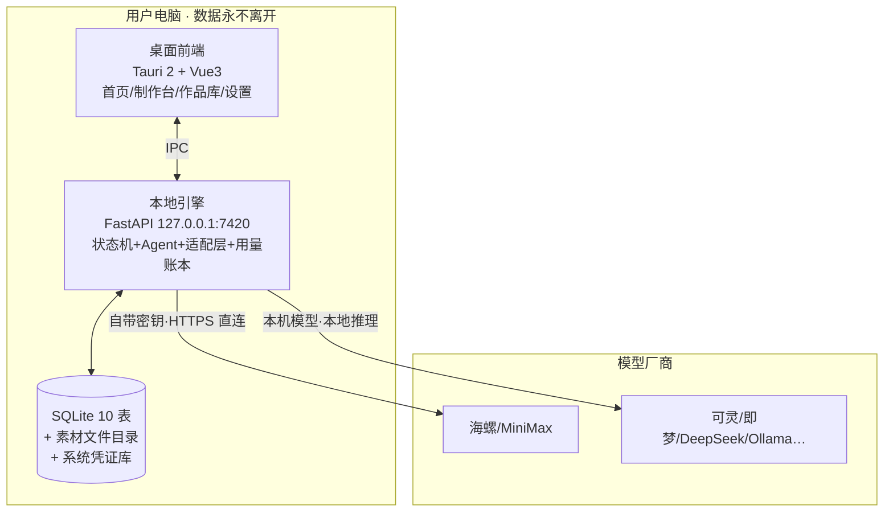
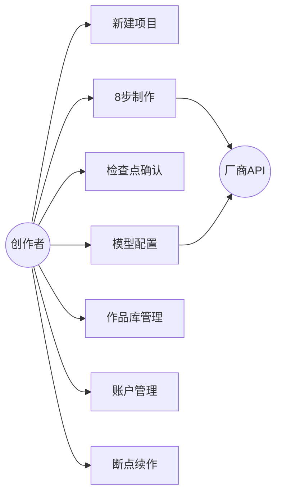
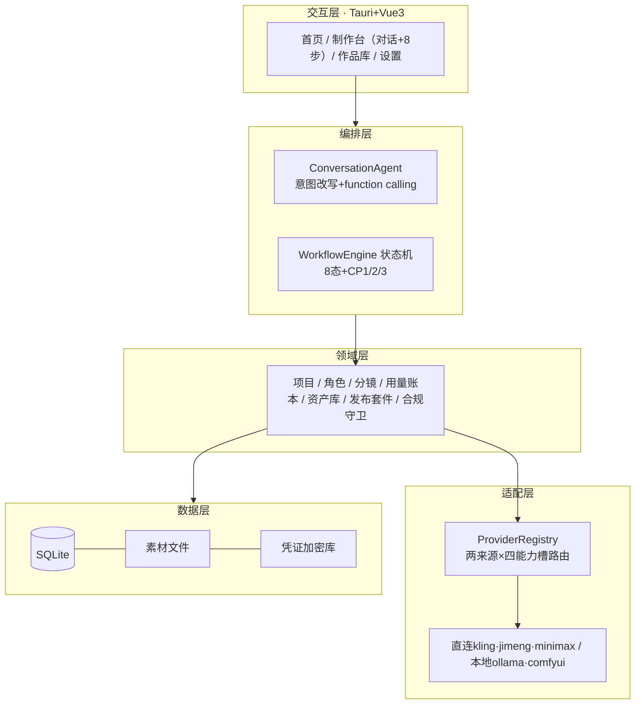
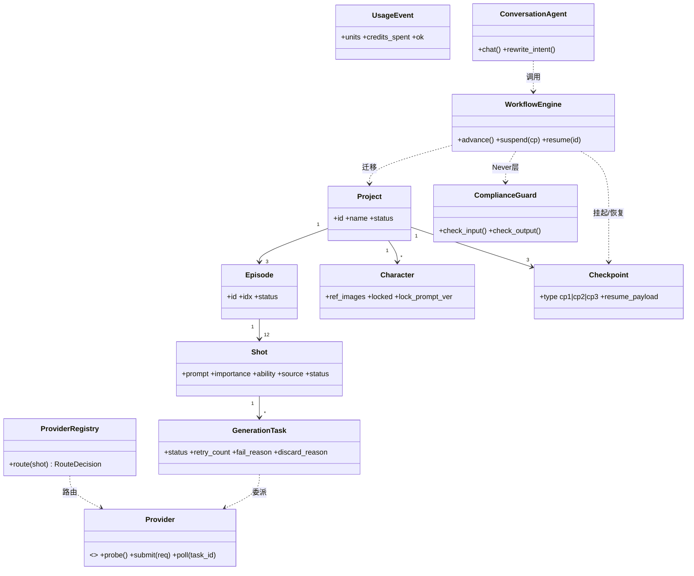
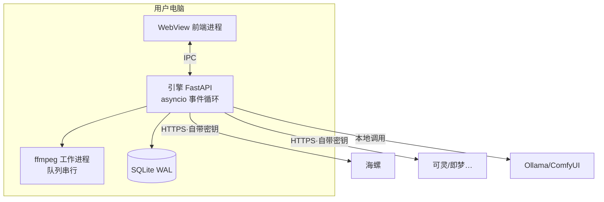
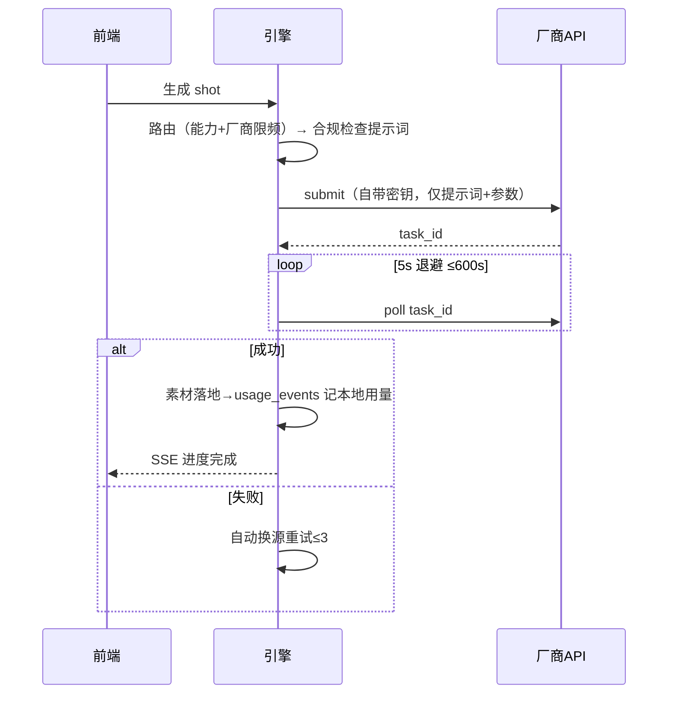
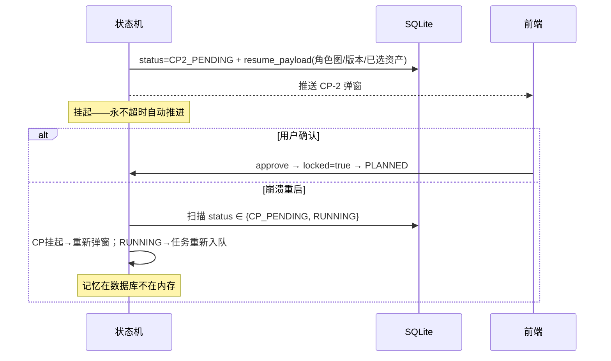
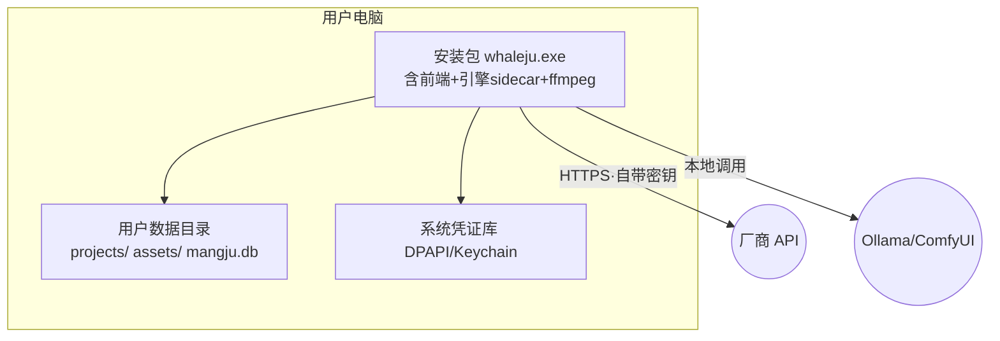
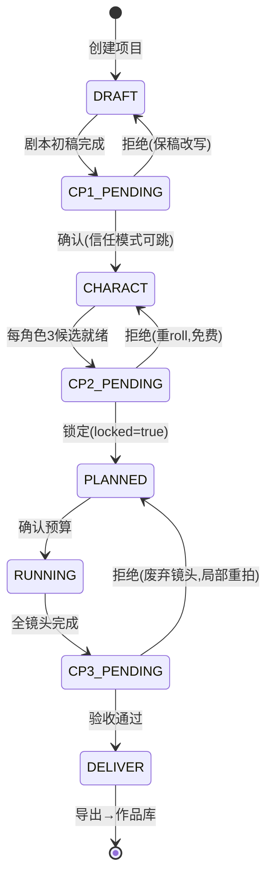

# WhaleJu（鲸鲨漫剧） 系统设计方案（架构 + 详细设计 合订本）v3.2

> **开源版修订说明（v3.2）**：本项目已定位为**纯开源免费软件（MIT）**。
> 原设计中与收费相关的部分——云网关（鉴权/积分/转发）、平台代采额度、credit_wallet 钱包、
> 冻结/结算账本、充值套餐——已全部移除，模型供给只保留「自带 API 密钥（owned）」与
> 「本机模型（local）」两种来源，全部直连厂商。本版本文档已按开源版口径全面改写。

> **本文自包含**：从产品定位到字段级接口一次读完，不依赖任何外部文档。
> 每张架构图均配「交互流程详解」文字描述；每个接口给出字段级参数表；每张表每个字段带注释。
> 阅读路径：第 1 章 5 分钟看懂全貌 → 第 2-9 章按需深读。
> 版本：v3.1 · 2026-11-18（v3.0 基础上按评审意见全面加深）

---

## 1. 一页看懂

### 1.1 产品是什么

**鲸鲨漫剧**是一个**本地优先的 AI 漫剧制片桌面应用**：创作者用一句话想法起步，Agent 按 8 步流程（写剧本→确认剧本→角色形象→锁定形象→拆分镜头→生成画面→看成片→导出视频）带其走完从想法到成片的全过程。

- **目标用户**：注册过即梦/可灵等模型账号、但没独立做出过完整连贯短剧的创作者
- **核心买点**：① 数据不出电脑 ② 模型全自带（自己的 API 密钥或本机模型，直连厂商）③ 三检查点止损 ④ 本地用量账本与成片率统计
- **商业模式**：完全免费开源（MIT），无订阅、无代采、无任何收费环节

### 1.2 架构一张图



**三条铁律**（贯穿全部设计）：
1. 单机自足——不依赖任何云服务，离线也能管理项目与作品
2. 密钥与素材只存本地——SQLite 里的凭证是密文，任何第三方（包括本项目作者）都拿不到
3. 只做流程编排——不训练模型、不部署自有推理、不碰用户厂商额度

### 1.3 技术决策一表（9 项 AI 工程技术）

| # | 技术 | 决策 | 一句话理由 |
|---|------|------|-----------|
| 1 | 用户数据隔离 | ✅ 架构级采用 | 单机物理隔离，数据永不出机 |
| 2 | 高并发 | ✅ 局部采用 | 引擎信号量限流；不上消息队列 |
| 3 | Multi-Agent 交叉验证 | ⚠️ 简化采用 | 双模型"审校员"模式；拒绝网状 Agent 编队 |
| 4 | 记忆断层 | ✅ 采用 | 状态持久化 + 结构化角色卡；不用向量库 |
| 5 | RAG 多链路/关联召回 | ⏸ V2 再上 | V1 数据量未达检索阈值；V2 方案已备（§7.5） |
| 6 | 图片/表格/公式识别 | ❌ 不采用 | 漫剧非文档场景，仅保留 VLM 图转提示词 |
| 7 | 问题重写与扩写 | ✅ 采用 | 对话 Agent 核心职责，带成本影响回显 |
| 8 | 评估 + 细粒度 Reranker | ⚠️ 轻量采用 | 定妆候选规则+VLM 打分排序；不部署独立服务 |
| 9 | Attention 推理优化 | ❌ 不采用 | 不训练不部署推理；优化责任在厂商侧 |

---

## 2. 产品需求与场景

### 2.1 功能范围（四视图，与原型一一对应）

| 模块 | 功能 | 关键交互 |
|---|---|---|
| 首页 | 一句话建项 / 题材模板填充 / 项目列表（进行中+已完成） | create / fillTpl / openProject |
| 制作台 | 8 步流程 + 三检查点 + 分镜表 + 角色卡 + 账单分列 + 对话修改 | goto / regen / confirm / lock / gen / play / export |
| 作品库 | 成片列表 / 下载 / 发布文案（含 AI 声明）/ 再剪一版 | download / copyCap / reedit |
| 设置 | 两来源×四能力槽配置 / 连接测试 / 账户菜单 | pickModel / testKey / um* |

### 2.2 核心场景

| # | 场景 | 主流程 | 非功能要求 |
|---|------|--------|-----------|
| S1 | 零基础首作 | 一句话→模板→8 步→作品库出 3 集 | 全程不看说明书；检查点 30 秒内可确认 |
| S2 | 多厂商生成 | 关键镜头走可灵(自带)、过场走海螺(自带另一把密钥)，用量分列 | 路由理由必须可见 |
| S3 | 检查点止损 | CP-2 锁定前重 roll 免费；CP-3 不过→局部重拍 | 锁定后角色一致性强约束 |
| S4 | 断点续作 | 崩溃/重启→扫描挂起状态→恢复现场 | 100% 恢复（混沌测试验收） |
| S5 | 合规导出 | 自动 AI 标识+字幕+发布文案声明 | Never 层红线先拦截 |

### 2.3 用例图



**用例图交互说明**：创作者（唯一人类角色）与 7 个用例直接交互；"8 步制作"和"模型配置"直达厂商 API——引擎带着用户自己的密钥 HTTPS 直连，中间没有任何平台设施。检查点确认（UC3）被设计为**只能由人类触发**——Agent 工具白名单中没有该能力（§5.3），这是"UC3 只有实线"背后的安全语义。

---

## 3. 总体架构（4+1 视图）

### 3.1 逻辑视图：五层架构



#### 3.1.1 交互流程详解（以"用户点击开始生成"为例的完整调用链）

1. **交互层→编排层**：用户在第 6 步页面点击"开始生成"，前端先调 `GET /generation/progress` 确认无进行中批次，再 `POST /generation/start`。请求经 Tauri IPC 发到引擎进程的 FastAPI（带本地鉴权 Token）。
2. **编排层内部**：WorkflowEngine 校验状态机守卫——当前必须处于 `PLANNED` 且模型能力已配置测通，守卫不过直接返回 E3001，**不触碰任何下层**；通过后状态迁移为 `RUNNING`，把 12 个镜头生成为 12 条 `generation_tasks`（status=queued）写入队列。
3. **编排层→领域层**：调度器从队列取任务，先过 ComplianceGuard（提示词红线检查——输入检查在生成前而非生成后），再向 ShotService 取该镜头的 prompt 与路由决策（路由在 PLANNED 阶段已快照进 shots 表，运行期不变，保证账单可复算）。
4. **领域层→适配层**：ProviderRegistry 按 `provider_id` 找到 adapter 实例 → 调 `submit()` 拿厂商任务号；随后任务交给独立 poller 协程轮询。
5. **适配层→数据层**：poll 得到 done 后，adapter 下载素材到项目素材目录 → AssetLibrary 计算 sha256、写 assets 表 → usage_events 记一条本地用量（成本按厂商公开单价估算）→ 状态回调 WorkflowEngine。
6. **编排层→交互层（反向通知）**：引擎通过 SSE 把进度事件推给前端（done/total/failed），前端 useGenStore 增量更新分镜表行状态——**前端不做任何业务判断，只渲染引擎事实**。

**失败路径**：poll 返回 fail_reason ∈ {timeout, rate_limit, provider_error} → 调度器按路由候选表换下一顺位源重入队（retry_count+1，≤3）；content_blocked → 不重试，标 failed 并触发合规提示；全部重试耗尽 → 该镜头标 failed，**批次继续跑完其余镜头**（单镜头失败不阻塞整批），CP-3 前给用户完整失败清单。

### 3.2 逻辑视图：核心类图



**类图关系与不变式（文字说明）**：

- **聚合链 `Project → Episode → Shot` 是数据主干**：一部剧 3 集、每集约 12 镜头。所有生成、计费、统计都挂在这条链上，任何报表都能沿链回溯到"哪部剧哪一集哪个镜头花了多少、成了没成"。
- **`Shot 1→* GenerationTask` 是"一次生成尝试"的完整历史**：同一镜头换源重试产生多条 task 记录（failed 的保留不删），成片率统计靠这条历史——这是产品的差异化数据资产，设计上**追加不覆盖**。
- **虚线依赖是控制流，实线聚合是数据流**：ConversationAgent、WorkflowEngine、ComplianceGuard 之间只有依赖没有持有——Agent 不缓存流程状态（每次调用都从引擎读），ComplianceGuard 是无状态纯函数（可独立单测）。这个切分让"编排逻辑"和"业务数据"分开演进。
- **Provider 是 Protocol（结构化接口）而非基类**：adapter 之间零继承零共享状态，厂商 API 变更的影响半径=1 个文件。Registry 持有全部 Provider 实例但只看 meta 声明、不知道厂商细节——依赖倒置，新增厂商不需要改 Registry。
- **Checkpoint 与 Project 分离**：检查点决策独立成表而非塞进 Project 字段，因为 resume_payload 是完整现场快照（大 JSON），混入主表会迅速膨胀，且检查点历史本身是审计数据（谁在何时放行了什么）。

### 3.3 过程视图：进程与并发



#### 3.3.1 进程模型与启动流程（文字详解）

**三个进程各司其职**：

- **WebView 前端进程**（Tauri 创建）：纯 UI，无业务逻辑、不直连外网（所有数据经引擎）。崩溃可被 Tauri 自动重启，业务无损。
- **引擎进程**（Python FastAPI，Tauri sidecar）：唯一的业务与数据管理者。**启动顺序**：①绑定 127.0.0.1:7420 并生成一次性鉴权 Token（经 IPC 给前端）→ ②打开 SQLite（WAL）→ ③从 OS 凭证库解密各槽密钥到内存（不落盘明文）→ ④**恢复扫描**（见下）→ ⑤注册 Provider 实例 → ⑥对外服务。
- **ffmpeg 工作进程**：按需 spawn 的短命进程，只做合成/加水印/压制三件事，经串行队列逐个执行（合成是 CPU 密集，串行防低配机卡死），完成即退出。**引擎与 ffmpeg 之间只传本地文件路径不传内存数据**——进程边界即故障边界，ffmpeg 崩溃只损失一次合成任务，重跑即可。

**恢复扫描（断点续作的核心，每次启动执行）**：
①查 `projects` 中 status ∈ {CP1/2/3_PENDING, RUNNING, DELIVER} 的项目 →
②CP 挂起态：读 checkpoints.resume_payload 还原现场并向前端推弹窗事件，**绝不自动 approve** →
③RUNNING 态：把 status=queued/running 的 generation_tasks 重新入队；provider_task_id 仍有效的直接续轮询（厂商任务幂等，不会重复计费），失效的重 submit →
④导出中断：幂等重跑（产物 sha256 相同直接复用）。

#### 3.3.2 并发设计（决策表 + 文字详解）

| 问题 | 方案 |
|---|---|
| 引擎并发 | asyncio + 信号量分桶：video≤3、image≤6、speech≤4、text≤2；同厂商并发≤2 |
| 视频异步 | 统一两段式 submit→poll，独立 poller 协程，5s 起指数退避（5/10/20/40s 封顶），≤600s 超时 |
| 状态与生成交错 | 生成只写 tasks/assets；状态迁移由事件回调驱动；SQLite 单写者免锁 |
| ffmpeg 合成 | 子进程 + 串行队列 |

**设计依据**：桌面端真实并发上限不是用户而是**厂商限频**——视频厂商普遍单 Key 并发 3-5，因此信号量分能力桶（按 ability）+ 厂商桶（按 provider_kind 叠加）两层闸门：既跑满厂商配额，又避免"一家限频连坐全部任务"。poller 用独立协程组而非每任务一线程：轮询是纯 IO 等待，单事件循环可稳定承载数百并发 poll（实际最多 12）。状态迁移收敛在引擎单写者，WAL 模式下读写不互斥——前端轮询读进度永不阻塞生成写。

#### 3.3.3 时序 1：镜头生成（直连厂商）



**逐步说明**：①前端只发起始请求，其后所有轮询/重试对用户透明（进度条由 SSE 驱动）。②请求只带提示词+参数，密钥在引擎侧注入 Header，厂商只看到一次普通 API 调用。③轮询 5s 起指数退避——厂商出片 1-10 分钟，前期高频轮询纯属浪费；600s 超时判 timeout 换源。④失败不产生任何扣费（厂商按成功任务计费），换源重试在引擎侧完成，用户只看到「该镜头自动重试中（第 2/3 次）」。

#### 3.3.4 时序 2：检查点挂起与崩溃恢复



**逐步说明**：①进入 CP 前**先写库再弹窗**（顺序不能反——先弹窗后写库时崩溃会丢现场）。②resume_payload 是**完整现场快照**：候选角色图 asset_id 列表、各候选打分、当前 prompt 版本——恢复时零重算。③"永不超时自动推进"是产品级承诺：用户可以锁屏睡觉，第二天回来决策现场原样。④崩溃后 RUNNING 态恢复的关键是**厂商任务幂等**：provider_task_id 仍有效则直接续轮询，不会让厂商重复执行同一任务。

### 3.4 开发视图：仓库与依赖

```
mangju/
├── desktop/              # Tauri 2 + Vue3（src/views: home/work/works/settings）
│   └── src-tauri/        # sidecar 管理、文件对话框、凭证托管
├── engine/app/           # Python FastAPI
│   ├── agent/            # ConversationAgent（工具白名单+意图改写）
│   ├── workflow/         # 状态机 + checkpoints + templates
│   ├── adapters/         # base.py 协议 / registry / kling_direct / ollama…
│   ├── storage/          # SQLite 10 表 + 素材索引
│   ├── publish/          # 发布文案+AI标识+ffmpeg
│   └── compliance/       # Never 层
└── docs/
```

**依赖规则（文字详解）**：依赖严格单向 `desktop → engine`，反向 import 在 CI 直接报错。engine 内部：`agent/workflow/publish` 只依赖 `adapters/base.py` 的 Protocol 定义，**禁止 import 任何具体厂商适配**——单测时可用 Mock Provider 替换全部外部依赖（状态机测试完全离线）。每个模块独立可测是单人维护底线：adapter 录制回放（vcrpy）、状态机纯函数表驱动、前端组件快照。

### 3.5 物理视图：部署



**部署与数据流（文字详解）**：

- **安装/更新流**：安装包 = Tauri 壳 + 前端资源 + Python 引擎（PyInstaller sidecar）+ 静态 ffmpeg，单 exe 分发。更新走 Tauri 签名自更新通道（校验失败拒装）；引擎与前端**同包同版**（杜绝前端新接口调旧引擎）。
- **运行数据流两条路**：①本地流（项目/素材/用量，全部落用户数据目录，永不出机器）；②厂商流（引擎→厂商 HTTPS 直连，载荷只有提示词+参数，**无素材上传**——生成结果由引擎从厂商结果 URL 直取到本机）。
- **故障降级矩阵**：某厂商故障→路由候选表自动换源；本机模型离线→改用云端密钥源，反之亦然。
- **信任边界**：用户机器（可信区：明文密钥仅在内存、密文在 DPAPI/Keychain）｜厂商（不可控区：只拿到单次请求的提示词）。没有平台——不存在第三方信任问题。

---

## 4. 数据库设计（SQLite，11 表全字段注释）

> 引擎为唯一写者；`PRAGMA journal_mode=WAL; PRAGMA foreign_keys=ON;`
> 所有表由触发器自动维护 `created_at`/`updated_at`（下略，不重复注释）。

### 4.1 projects — 项目主表

```sql
CREATE TABLE projects (
  id          TEXT PRIMARY KEY,      -- 项目唯一标识（ULID，时间有序：列表排序免二次转换）
  name        TEXT NOT NULL,         -- 项目名（LLM 从想法中提取，用户可改）
  template_id TEXT NOT NULL,         -- 流程模板标识；V1 固定 'life_3ep'（3集短剧），扩展题材时新增
  idea_text   TEXT NOT NULL,         -- 用户首页输入的原始一句话（不改写不清洗；审计与回归测试锚点）
  status      TEXT NOT NULL,         -- 状态机当前态：DRAFT/CP1_PENDING/CHARACT/CP2_PENDING/PLANNED/RUNNING/CP3_PENDING/DELIVER（枚举见 §5.1）
  deleted_at  TEXT                   -- 软删时间戳；NULL=正常。删除进回收站目录，7 天后清理任务物理删除
);
```

**设计说明**：项目表刻意保持"薄"——只存身份与状态，业务细节全在子表。`status` 是全表唯一高频更新列，与低频身份数据分离减少写放大。`idea_text` 永不修改：Agent 后续一切改写都是新版本（prompt_ver / checkpoints 链），原始输入是不可变的审计锚点。

### 4.2 episodes — 集

```sql
CREATE TABLE episodes (
  id         TEXT PRIMARY KEY,       -- 集唯一标识（ULID）
  project_id TEXT NOT NULL REFERENCES projects(id),  -- 所属项目（级联删除）
  idx        INTEGER NOT NULL,       -- 集序号 1..3（由模板决定，不硬编码上限）
  status     TEXT NOT NULL DEFAULT 'pending',  -- 本集进度：pending/scripted/generated/exported
  UNIQUE(project_id, idx)            -- 同项目内集号唯一
);
```

**设计说明**：集级独立状态为作品库服务——成片按集交付：`exported` 的集进作品库，其余集可能还在返工。项目状态（全剧维度）与集状态（单集维度）是两层进度：UI 的 8 步条看项目态、作品库看集态。

### 4.3 characters — 角色卡（一致性锚点）

```sql
CREATE TABLE characters (
  id              TEXT PRIMARY KEY,        -- 角色唯一标识（ULID）
  project_id      TEXT NOT NULL REFERENCES projects(id),  -- 所属项目
  name            TEXT NOT NULL,           -- 角色名（如"少年·十八岁"）
  desc_text       TEXT NOT NULL,           -- 外貌文字描述（发型/脸型/服装/气质）：生成定妆图和后续所有镜头注入的一致性锚点；锁定后视为冻结基准
  ref_images      TEXT NOT NULL,           -- JSON 数组：定妆候选 [{asset_id, score, rank}]；score=综合分，rank=呈现排序；锁定后不再变更
  locked          INTEGER NOT NULL DEFAULT 0,  -- 0=未锁定（重roll免费）/1=已锁定（CP-2 确认，全剧注入）
  lock_prompt_ver INTEGER,                 -- 锁定瞬间的提示词版本号；解锁重roll后失效，用于判断"哪些镜头需要一致性重拍"
  CHECK (locked IN (0,1))
);
```

**设计说明**：这张表是"记忆断层"技术方案的落点（§7.4）。角色一致性不靠模型记忆，靠**注入**：每个镜头的提示词组包时拼入 desc_text + 锁定版 ref_image 引用。`lock_prompt_ver` 是止损开关——CP-3 拒绝回到 PLANNED 时，只有 prompt_ver > lock_prompt_ver 的镜头才需重拍，未受影响的镜头产物直接复用。

### 4.4 shots — 分镜镜头

```sql
CREATE TABLE shots (
  id          TEXT PRIMARY KEY,      -- 镜头唯一标识（ULID）
  episode_id  TEXT NOT NULL REFERENCES episodes(id),  -- 所属集
  idx         INTEGER NOT NULL,      -- 集内镜头序号（决定成片拼接顺序）
  scene_desc  TEXT NOT NULL,         -- 场景描述（自然语言，"院子·晾衣绳·黄昏"），给用户看
  prompt      TEXT NOT NULL,         -- 生成提示词（scene_desc+角色注入+风格模板组装；每次修改 ver+1，旧版不覆盖）
  prompt_ver  INTEGER NOT NULL DEFAULT 1,  -- 提示词版本；与 generation_tasks.request_hash 联动实现"改过的镜头才重新生成"
  importance  TEXT NOT NULL,         -- 镜头分级：key(关键镜头，画质优先)/transition(过场镜头，成本优先)——路由规则主输入
  ability     TEXT NOT NULL,         -- 能力槽：text/image/video/speech（V1 主用 video；image 用于定妆与首帧）
  source      TEXT NOT NULL,         -- 算力来源：owned(自带密钥)/local(本地模型)
  provider_id TEXT,                  -- 路由决策写入的具体 Provider（PLANNED 阶段快照，运行期不变，保证账单可复算）
  status      TEXT NOT NULL DEFAULT 'planned'  -- planned/queued/running/done/failed/discarded
);
```

**设计说明**：`importance + source + provider_id` 的组合是**路由快照**。快照而非实时路由的原因：预算确认时用户看到的是按这套路由算的预估账单，生成期路由必须与预估一致，否则账单不可复算、信任崩塌。想换路由只能回 PLANNED 重新确认。

### 4.5 generation_tasks — 生成任务（成片率的原子数据）

```sql
CREATE TABLE generation_tasks (
  id               TEXT PRIMARY KEY,      -- 任务唯一标识（ULID）
  shot_id          TEXT NOT NULL REFERENCES shots(id),  -- 目标镜头
  provider_id      TEXT NOT NULL,         -- 本次尝试使用的 Provider
  request_hash     TEXT NOT NULL,         -- sha256(shot_id+prompt_ver+provider_id+参数)；幂等键，防同一组合重复提交重复扣费
  status           TEXT NOT NULL,         -- queued/running/done/failed/discarded
  retry_count      INTEGER NOT NULL DEFAULT 0,  -- 已重试次数（换源累计），上限 3
  fail_reason      TEXT,                  -- 失败原因：timeout/rate_limit/content_blocked/provider_error/unknown——content_blocked 不重试，联动合规提示
  discard_reason   TEXT,                  -- 废弃原因：cp3_rejected(CP-3 验收不过)/user_discard(用户手动弃)——与 fail_reason 分离：废弃是用户决策、失败是技术结果
  provider_task_id TEXT,                  -- 厂商侧异步任务号；崩溃恢复凭它续轮询而无需重新提交扣费
  UNIQUE(shot_id, request_hash)           -- 幂等约束：同镜头同参数同厂商只允许一条任务
);
CREATE INDEX idx_tasks_status ON generation_tasks(status);  -- 调度器按状态扫队列
```

**设计说明**：全库最重要的表——**成片率统计唯一数据源**。`fail_reason × provider × importance` 聚合即可回答"哪类镜头用哪家模型通过率高"，直接反哺路由候选表（§7.8）。设计原则**追加不覆盖**：换源重试产生新行而非改旧行，历史尝试全部保留。

### 4.6 assets — 素材文件索引

```sql
CREATE TABLE assets (
  id           TEXT PRIMARY KEY,      -- 素材唯一标识（ULID）
  project_id   TEXT NOT NULL REFERENCES projects(id),  -- 所属项目（素材按项目目录隔离）
  kind         TEXT NOT NULL,         -- 类型：image(定妆/首帧)/video(镜头成片)/audio(TTS)/script(剧本文档)/work(最终导出成片)
  local_path   TEXT NOT NULL,         -- 相对用户数据目录的路径（不存绝对路径——数据目录可迁移）
  sha256       TEXT NOT NULL,         -- 文件内容哈希：完整性校验、去重、导出幂等三用途
  shot_id      TEXT REFERENCES shots(id),      -- 关联镜头（生成类素材）
  character_id TEXT REFERENCES characters(id), -- 关联角色（定妆类素材）
  size_bytes   INTEGER NOT NULL      -- 文件大小（字节），账单与回收站清理用
);
```

**设计说明**：库里只存索引，二进制永远在文件系统（SQLite 不进大对象，防库膨胀）。`kind` 决定下游行为：video 进拼接队列、work 进作品库、image 可被角色卡引用。

### 4.7 checkpoints — 检查点决策

```sql
CREATE TABLE checkpoints (
  id             TEXT PRIMARY KEY,      -- 检查点记录唯一标识（ULID）
  project_id     TEXT NOT NULL REFERENCES projects(id),  -- 所属项目
  type           TEXT NOT NULL,         -- cp1(剧本确认)/cp2(角色锁定)/cp3(样片验收)
  status         TEXT NOT NULL,         -- pending(等待决策)/approved(通过)/rejected(拒绝)
  resume_payload TEXT NOT NULL,         -- 挂起现场完整快照(JSON)：cp2={候选图列表,打分,当前prompt_ver}；恢复时零重算
  decided_at     TEXT                   -- 用户决策时间戳（审计：谁在何时放行了什么）
);
```

**设计说明**：独立成表的原因见 §3.2——resume_payload 是大 JSON，且检查点历史本身是审计数据（CP-3 拒绝过什么决定了哪些镜头被废弃，责任链可回溯）。

### 4.8 usage_events — 用量事件（双源记账）

```sql
CREATE TABLE usage_events (
  id                TEXT PRIMARY KEY,  -- 事件唯一标识（ULID）
  ts                TEXT NOT NULL,     -- 事件时间(ISO 8601)；账单按月聚合的分组键
  project_id        TEXT,              -- 关联项目（可空：账户级操作如连接测试也记账）
  provider_id       TEXT NOT NULL,     -- Provider 标识
  source            TEXT NOT NULL,     -- proxy/owned/local——账单页"按来源分列"的依据
  ability           TEXT NOT NULL,     -- 能力槽 text/image/video/speech
  units             REAL NOT NULL,     -- 计费单位数（视频秒/图片张/文本千字）
  credits_spent     REAL NOT NULL DEFAULT 0,  -- 平台积分字段（开源版恒为 0，保留兼容历史报表）
  raw_cost_estimate REAL NOT NULL DEFAULT 0,  -- 按厂商公开单价估算的成本，供用量统计参考
  ok                INTEGER NOT NULL,  -- 1=成功 0=失败（成片率分子分母）
  fail_reason       TEXT               -- 失败原因（冗余自 tasks，便于单表统计）
);
CREATE INDEX idx_usage_ts ON usage_events(ts);  -- 时间范围查询（月账单/成片率趋势）
```

**设计说明**：**BYOM 也记账**（credits_spent=0 但 units/raw_cost 照记）是刻意设计——成片率统计需要全量数据，且"自带密钥省了多少"可量化展示，是转化付费的核心话术，数据来自这张表。

### 4.9 model_configs — 模型配置（四槽）

```sql
CREATE TABLE model_configs (
  id                TEXT PRIMARY KEY,  -- 配置唯一标识（ULID）
  slot              TEXT NOT NULL,     -- 能力槽：text/image/video/speech
  source            TEXT NOT NULL,     -- owned(自带密钥)/local(本地模型)
  provider_kind     TEXT NOT NULL,     -- 适配器类型：openai_compat/kling/jimeng/helo/ollama/comfyui——决定实例化哪个 adapter
  name              TEXT NOT NULL,     -- 用户可读名（"我的可灵账号"）
  endpoint          TEXT,              -- 自建/本地模型地址（http://localhost:11434）；云端厂商为空用内置默认
  credential_cipher BLOB,              -- 密钥密文(AES-256-GCM，主密钥在 OS 凭证库)；任何查询接口绝不返回此字段
  abilities         TEXT NOT NULL,     -- JSON：probe 实测可用能力清单（用户填了 Key 但没开视频权限时，路由据此排除）
  is_active         INTEGER NOT NULL DEFAULT 1  -- 同槽仅一条激活（部分唯一索引 WHERE is_active=1）
);
```

### 4.10 agent_history — 对话记忆

```sql
CREATE TABLE agent_history (
  id          TEXT PRIMARY KEY,  -- 消息唯一标识（ULID）
  project_id  TEXT,              -- 关联项目（可空：全局闲聊）
  role        TEXT NOT NULL,     -- user/agent/system
  content     TEXT NOT NULL,     -- 消息正文
  intent_json TEXT,              -- agent 消息的结构化意图快照 {op,scope,cost_impact,confirmed}——未确认意图不执行，此字段是确认状态载体
  summary_to  TEXT               -- 压缩标记：指向某消息 id，表示该 id 之前的历史已压缩进该条摘要（记忆管理见 §5.3）
);
```

### 4.12 表间关系总览

```
projects 1─┬─3 episodes 1─┬─12 shots 1─* generation_tasks
           ├─* characters ─* assets（定妆引用）
           └─3 checkpoints ──  assets（镜头产物/work 引用）
usage_events ──(project_id 弱关联，含账户级事件)
model_configs / agent_history —— 独立
```

---

## 5. 核心机制详细设计

### 5.1 状态机（8 态 + 三检查点）



**完整迁移表**（事件/守卫/动作/次态）：

| 当前态 | 事件 | 守卫 | 动作 | 次态 |
|---|---|---|---|---|
| DRAFT | script_ready | — | 生成大纲+看点标签 | CP1_PENDING |
| CP1_PENDING | approve | — | 版本定稿 | CHARACT |
| CP1_PENDING | approve | trust_mode | 仍记录 checkpoints 行 | CHARACT |
| CP1_PENDING | reject | — | 保留原稿，prompt_ver++ | DRAFT |
| CHARACT | roles_ready | 每角色≥1 候选 | 打分排序 | CP2_PENDING |
| CP2_PENDING | approve | sel≥1 | locked=1，写 lock_prompt_ver | PLANNED |
| CP2_PENDING | reject | — | 重 roll（不扣费） | CHARACT |
| PLANNED | budget_confirmed | est ≤ 可用额度 | 路由快照入 shots | RUNNING |
| PLANNED | budget_confirmed | 模型未配置测通 | 返回 E3001，引导到设置页 | PLANNED |
| RUNNING | all_done | — | 合成 30s 样片 | CP3_PENDING |
| RUNNING | task_failed | 重试耗尽 | 标记 failed，继续其余镜头 | RUNNING |
| CP3_PENDING | approve | — | 全量合成入队 | DELIVER |
| CP3_PENDING | reject | — | discard_reason=cp3_rejected | PLANNED |
| DELIVER | export_done | — | 写 works+文案缓存 | 终态 |

**状态机工作机制（文字详解）**：

- **实现形态**：纯函数表驱动——`(当前态, 事件, 守卫结果) → (动作列表, 次态)` 存为静态迁移表，`WorkflowEngine.advance()` 查表执行。迁移表可直接转 pytest 用例（每行一条测试），改流程=改表+改测试同步提交。
- **守卫先行**：任何事件先评估守卫，守卫不过则**零副作用**（不写库不调下游），返回错误码。预算守卫把"额度不足"挡在生成开始前，而不是跑到一半没钱。
- **写序保证**：每次迁移落库顺序固定为"先写 checkpoints/resume_payload（若有挂起）→ 再改 projects.status → 最后发 UI 事件"。崩溃落在任何两点之间，重启扫描都得到一致状态（要么旧态+已存快照，要么新态），**不存在中间态**。
- **拒绝路径的产品语义**：CP-1 拒绝=保留原稿重来一版（旧版本不删，可回看对比）；CP-2 拒绝=重 roll 免费（锁定前的尝试不收费是信任设计）；CP-3 拒绝=只废弃勾选镜头回 PLANNED，通过验收的镜头产物直接复用（配合 lock_prompt_ver，重拍成本最小化）。
- **崩溃恢复**：启动扫描见 §3.3.1；核心是幂等——provider_task_id 防重复提交。

### 5.2 模型适配层

**统一协议（伪异步——上层只见一种两段式）**：

```python
@dataclass
class TextGenRequest:  prompt: str; system: str; max_tokens: int; temperature: float
@dataclass
class ImageGenRequest: prompt: str; ref_image_asset: str | None; size: str
@dataclass
class VideoGenRequest: prompt: str; first_frame_asset: str | None; duration_s: int; ratio: str
@dataclass
class SpeechRequest:   text: str; voice_id: str; speed: float

@dataclass
class GenResult:
    ok: bool; asset_ref: str | None; units_used: float
    raw_cost_estimate: float; fail_reason: str | None; provider_task_id: str | None

class Provider(Protocol):
    meta: ProviderMeta       # id/kind/source/abilities/单价提示
    async def probe(self) -> ProbeResult           # 10s 超时连接测试
    async def submit(self, req) -> str             # 文本/生图内部即完成（伪异步）
    async def poll(self, task_id) -> GenResult
```

**适配层工作机制（文字详解）**：

- **为什么统一两段式**：文本/生图 API 是同步的（一次 HTTP 返回），视频 API 是异步的（提交拿任务号再轮询）。若协议如实暴露差异，上层调度要为每种能力写一套逻辑。统一 `submit→poll` 后，文本适配器在 submit 内完成调用、poll 立即返回——**调度器、计费、重试、状态机全部只写一份**。用适配层的微小复杂度换编排层的完全简单。
- **路由是可解释规则引擎**：优先级为"用户显式指定 > 成片率统计 > 成本规则 > 默认"。每个决策必须产出 `reason`（"关键镜头走可灵：你的成片率 78% > 64%"），UI 强制展示——路由黑箱会摧毁"账单可复算"的信任。路由结果在 PLANNED 阶段快照进 shots 表，运行期不变（§4.4）。

| 槽 | 默认路由 | 换源重试 |
|---|---|---|
| text | 自带(OpenAI兼容)→本地(Ollama)→提示配置 | 不重试 |
| image | 自带即梦→本地 ComfyUI | ≤1 次 |
| video | 关键镜头→可灵(自带优先)；过场→海螺(自带)；通过率差>15% 反转 | ≤3 次 |
| speech | 本地 edge-tts(免费)→自带 MiniMax | ≤1 次 |

- **重试分类学**：`fail_reason ∈ {timeout, rate_limit, provider_error}` 才换源（技术性失败值得再试别家）；`content_blocked` 不重试（换一家大概率还是拦，正确动作是提示用户改词——联动合规）；重试换**候选表下一顺位**而非随机。
- **并发闸门**：能力桶（video≤3/image≤6/speech≤4/text≤2）与厂商桶（同 provider_kind≤2）叠加限流——跑满厂商配额又防单家限频连坐。

### 5.3 对话 Agent（安全边界 + 意图改写 + 记忆）

**工具白名单（全量 7 个，代码即 Never 层）**：

| 工具 | 参数 | 作用 |
|---|---|---|
| get_script | ver? | 读剧本 |
| get_shots | episode_idx? | 读分镜表 |
| get_characters | — | 读角色卡 |
| regen_script | note: str | 重写剧本（带用户意见） |
| adjust_pacing | episode_idx, op: speed_up\|expand, insert_count? | 节奏调整，返回 cost_impact |
| swap_role_image | role_id: str | 单角色重 roll |
| answer_question | text: str | 纯回复，不动状态 |
| route_to_recharge / route_to_settings | — | 前端页面跳转 |

**Agent 安全模型（文字详解）**：

- **白名单即边界**：Agent 能调用的 function 是编译期写死的白名单。**没有 approve_checkpoint、没有 start_generation、没有任何扣费工具**——检查点与预算确认只能由用户在 UI 点击触发。这比"提示词里要求 Agent 别扣费"强一个数量级：提示词可被越狱，代码白名单不能。UI 弹窗无跳过按钮 + 引擎无跳过 API，双保险。
- **意图改写管线**：用户口语（"第二集太快了"）不可直接执行。管线：①分类 {剧本/镜头/角色/账户/闲聊} → ②LLM 单次调用改写为结构三元组 `{op: pacing_expand, scope: episode_2, cost_impact: +9 额度, confirm: "要在站台戏前加 1 个铺垫镜头，多花约 9 额度，继续吗？"}` → ③SSE 推送 intent 事件回显 → ④用户确认后**前端**调对应业务接口执行。**未确认的写操作一律拒绝**——Agent 永远不会"顺手"替用户花钱。
- **记忆管理（三段式）**：短期=最近 20 轮原文进上下文；超过 20 轮，旧对话由小模型压缩为 ≤200 字摘要写入标记行（summary_to 指向），此后上下文=摘要头+近 20 轮；**事实记忆不进对话**——角色长相/镜头状态/版本号/已花金额全在结构化表，Agent 每次用 get_* 工具按需查询。对话记忆只存"用户偏好与修改历史"这类模糊信息，事实永远查库——杜绝"聊久了 Agent 忘了主角长什么样"。

### 5.4 用量账本（本地）

- **只记不扣**：纯开源版没有任何平台扣费。usage_events 逐条记录每次生成的厂商、能力、单位数与成本估算（按厂商公开单价折算），供「用量统计」查看与成片率分析。
- ** credits_spent 恒为 0**：字段保留以兼容历史数据与报表结构，但永远不会被写入非零值。

### 5.5 合规 Never 层（规则表）

| 检查点 | 规则 | 处置 |
|---|---|---|
| 输入 | 上传视频/他人成片（扩展名+时长+来源声明判定） | 拒绝+引导合法替代（授权网文/原创） |
| 输入 | 剧本命中红线词库（涉政/低俗/侵权） | 高危拒绝生成；中危标注供 CP-1 展示 |
| 生成 | 厂商返回 content_blocked | 不重试，给改写方向 |
| 导出 | ai_badge 恒 true（API 忽略 false） | ffmpeg 烧录 AI 标识 |
| 发布 | 文案强制含 AI 生成声明 | 声明段模板锁定，LLM 只填正文 |

**工作机制**：ComplianceGuard 是无状态纯函数组件，两处挂载——输入侧在 DRAFT 阶段和 Agent 的 regen 工具执行前；输出侧在导出与发布文案组装时。规则以数据表内置（词库随版本更新），高危命中即硬拦截返回 E5001，中危仅标注不阻断（判断权留给用户，检查点呈现）。

---

## 6. 接口设计（字段级）

### 6.0 通用约定

| 项 | 约定 |
|---|---|
| 引擎 Base | `http://127.0.0.1:7420/api`（仅本机监听） |
| 鉴权 | `Authorization: Bearer <local_token>`；token 引擎启动时生成、经 IPC 给前端、每次重启轮换——防本机其他进程嗅探复用 |
| 时间格式 | ISO 8601 带时区 `2026-11-18T21:00:00+08:00` |
| 分页 | `?limit=50&cursor=<id>`，响应含 `next_cursor`（null=末页） |
| ID 格式 | ULID（26 位，时间有序） |
| 错误信封 | `{"error":{"code":"E3001","message":"模型还没配置好…","detail":{…}}}`，错误码见 §8.2 |
| 幂等 | 写操作带 `request_id`（前端 ULID），引擎按其去重——网络重试不产生重复副作用 |

### 6.1 项目与首页

#### POST /api/projects — 创建项目

**请求参数**：

| 参数 | 类型 | 必填 | 说明 |
|---|---|---|---|
| idea | string | 是 | 一句话想法，10–2000 字；原样存入 projects.idea_text，不做清洗 |
| template_id | string | 是 | 题材模板：`life_3ep`(普通人的一生)/`city_3ep`(都市逆袭)/`mystery_3ep`(悬疑反转) |

**响应参数**（200）：

| 字段 | 类型 | 说明 |
|---|---|---|
| id | string | 新项目 ULID |
| name | string | LLM 从想法提取的项目名（用户可改） |
| status | string | 恒 `DRAFT`（创建即进第 1 步） |
| episode_count | int | 模板决定的集数（V1=3） |
| next_action | string | 前端引导标识："draft_script"（去写剧本） |

错误：E1001 引擎未就绪。

#### GET /api/projects — 项目列表

请求（Query）：`status`（active|deleted，默认 active）、`limit`（默认 50）、`cursor`。

**响应参数**（200）：

| 字段 | 类型 | 说明 |
|---|---|---|
| items[].id | string | 项目 ID |
| items[].name | string | 项目名 |
| items[].cover_asset_id | string? | 封面素材（首张定妆图）；新项目 null，前端用中性占位 |
| items[].status | string | 状态机当前态 |
| items[].step_index / step_total | int | 进度（如 4/8，由状态机态换算） |
| items[].updated_at | string | 最近更新时间（列表按此倒序） |
| next_cursor | string? | 分页游标 |

#### GET /api/projects/{id} — 项目详情（打开项目/断点恢复）

**响应参数**（200）：

| 字段 | 类型 | 说明 |
|---|---|---|
| id / name / status / episode_count | — | 同创建 |
| current_step | string | 状态机态；CP*_PENDING 时前端立即弹检查点 |
| resume_hint | string | 恢复提示白话文："还有 5 个角色形象待确认" |

错误：E1002 项目不存在 / E1003 已删除。

#### DELETE /api/projects/{id} — 删除（软删）

响应 204。素材移入回收站目录，7 天后物理清除；期间可恢复。

### 6.2 制作流程

#### POST /api/projects/{id}/steps/{step}/advance — 检查点/步骤确认

**请求参数**：

| 参数 | 类型 | 必填 | 说明 |
|---|---|---|---|
| step | path int | 是 | 步骤号 1–8（2=CP-1，4=CP-2，7=CP-3） |
| action | string | 是 | `approve` / `reject` |
| payload | object | 否 | 步骤相关：CP-2 approve `{"selected":["char_xxx"]}`；CP-3 reject `{"discard_shots":["sht_xxx"]}` |

**响应参数**（200）：

| 字段 | 类型 | 说明 |
|---|---|---|
| project_status | string | 迁移后的状态机态 |
| effects | string[] | 副作用清单，如 `["characters_locked"]`、`["shots_discarded:3"]`——前端据此弹 toast |

错误：E3001 未到确认时机 / E3002 尝试跳过不可跳步骤（CP-2/CP-3）。

#### POST /api/projects/{id}/regen — 重新生成

**请求参数**：

| 参数 | 类型 | 必填 | 说明 |
|---|---|---|---|
| target | string | 是 | `script`(整稿重写)/`roles`(全部角色重roll)/`role_image`(单角色重roll) |
| role_id | string | target=role_image 必填 | 目标角色 ID |
| note | string | 否 | 用户意见（"第二集节奏慢一点"），注入改写提示词 |

响应（200）：`task_id`（异步任务号）、`free`（bool：CP-2 锁定前角色重 roll 为 true，不产生扣费）。

#### GET /api/projects/{id}/script?ver= — 剧本稿

**响应参数**（200）：

| 字段 | 类型 | 说明 |
|---|---|---|
| ver | int | 稿号（第 N 稿）；不传 ver 返回最新稿 |
| content | string | 剧本正文（Markdown） |
| highlights[] | object | 情绪高点 `{start,end,type:"climax|hook"}`，前端高亮 |
| risk_notes[] | string | 合规中危标注（高危在生成时已拦截，到不了这里） |

#### GET /api/projects/{id}/outline — 三集大纲

**响应参数**（200）：

| 字段 | 类型 | 说明 |
|---|---|---|
| episodes[].idx | int | 集号 1–3 |
| episodes[].title | string | 集标题（"院子"） |
| episodes[].summary | string | 本集梗概（≤100 字） |
| episodes[].beats[] | object | 看点标签 `{t:"00:45", label:"情绪反转"}` |

#### GET /api/projects/{id}/characters — 角色列表

**响应参数**（200）：

| 字段 | 类型 | 说明 |
|---|---|---|
| items[].id | string | 角色 ID |
| items[].name | string | 角色名 |
| items[].desc | string | 外貌文字描述 |
| items[].locked | bool | 锁定态 |
| items[].candidates[] | object | 3 张定妆候选 `{asset_id, score(0-100), rank(呈现序)}`——score=要素命中规则分 60%+VLM 一致性/画质分 40%（§7.8） |

#### GET /api/projects/{id}/shots — 分镜表

**响应参数**（200）：

| 字段 | 类型 | 说明 |
|---|---|---|
| items[].id / idx | string/int | 镜头 ID 与集内序号 |
| items[].scene_desc | string | 场景描述（用户视角） |
| items[].importance | string | key / transition |
| items[].ability | string | 能力槽 |
| items[].route.source | string | proxy / owned / local |
| items[].route.provider_id | string | 具体 Provider |
| items[].route.reason | string | 路由理由（白话，UI 气泡强制展示） |
| items[].est_cost | float | 单镜头预估成本（额度） |
| items[].status | string | planned/queued/running/done/failed/discarded |
| items[].asset_id | string? | 完成后的产物素材 ID |
| est_total | float | 全部镜头预估合计（预算确认页展示） |

#### POST /api/projects/{id}/generation/start — 开始生成

请求：无 body（路由与预算已在 advance 确认）。
响应（200）：`batch_id`（批次号）、`queued`（入队镜头数）。
错误：E3001 模型未配置测通（引导到设置页）。

#### POST /api/projects/{id}/generation/pause — 暂停

响应（200）：`paused: true`、`done`/`total`。运行中任务自然完成后不再取新任务，进度全保留。

#### GET /api/projects/{id}/generation/progress — 进度

**响应参数**（200）：

| 字段 | 类型 | 说明 |
|---|---|---|
| done / total / running / failed | int | 计数 |
| failed_items[] | object | `{shot_id, scene_desc, fail_reason, auto_retry_left}`——带白话场景名便于定位 |
| eta_s | int? | 预计剩余秒数（按已完成镜头平均耗时外推） |

#### GET /api/projects/{id}/preview — CP-3 样片

响应（200）：`asset_id`、`duration_s`（约 30）、`local_path`（低码率 mp4，ffmpeg 预合成）。

#### POST /api/projects/{id}/export — 导出

**请求参数**：

| 参数 | 类型 | 必填 | 说明 |
|---|---|---|---|
| ratio | string | 是 | `9:16`（默认）/`16:9` |
| with_subtitle | bool | 否 | 烧录字幕，默认 true |
| ai_badge | bool | — | **服务端恒置 true，传 false 被忽略**（Never 层，§5.5） |

响应（200）：`task_id`。

#### GET /api/exports/{task_id} — 导出进度轮询

**响应参数**（200）：

| 字段 | 类型 | 说明 |
|---|---|---|
| state | string | running / done / failed |
| pct | int | 0–100（running 时） |
| work_id | string | done 时：作品库条目 ID |
| local_path | string | done 时：成片路径（前端调系统保存对话框） |

错误：E6001 导出失败（未扣额度，可重试）。

### 6.3 作品库与发布

#### GET /api/works — 成片列表

**响应参数**（200）：

| 字段 | 类型 | 说明 |
|---|---|---|
| items[].id | string | 作品 ID |
| items[].project_name | string | 来源项目名 |
| items[].episode_idx / title | int/string | 集号与标题 |
| items[].duration_s | int | 时长秒 |
| items[].size_mb | float | 文件大小 |
| items[].ratio | string | 画幅 |
| items[].exported_at | string | 导出时间 |
| items[].ai_badged | bool | 恒 true（展示用） |
| next_cursor | string? | 分页 |

#### GET /api/works/{id}/caption — 发布文案

响应（200）：`caption`（完整文案，末段为锁定的 AI 生成声明）、`cached`（bool：是否命中缓存；首次由 LLM 生成后落库）。

#### POST /api/works/{id}/reedit — 再剪一版

响应（200）：`project_id`（衍生新项目 ID；**复用原素材引用不复制文件**，编辑结果不影响原成片）。

### 6.4 模型设置与钱包

#### GET /api/model-configs — 当前配置

**响应参数**（200）：

| 字段 | 类型 | 说明 |
|---|---|---|
| slots.text/image/video/speech | object | 每槽激活配置 `{source, provider_kind, name, status(probed_ok/stale/unset), last_probe_at}`；**不含密钥** |

#### POST /api/model-configs/{slot}/test — 连接测试

请求：path `slot`，body 无。
**响应参数**（200）：

| 字段 | 类型 | 说明 |
|---|---|---|
| ok | bool | 是否可用 |
| latency_ms | int | 探测延迟 |
| abilities | string[] | 实测可用能力（填 Key 但未开某权限时如实反映，路由据此排除） |
| price_hint | string? | 单价提示（"约 0.05 元/张"），公开口径估算 |

#### PUT /api/model-configs/{slot} — 保存配置

**请求参数**：

| 参数 | 类型 | 必填 | 说明 |
|---|---|---|---|
| source | string | 是 | proxy / owned / local |
| provider_kind | string | 是 | openai_compat/kling/jimeng/ollama/comfyui |
| name | string | 是 | 用户可读名 |
| endpoint | string | local 必填 | 服务地址 |
| credential | string | owned/local 必填 | 密钥明文（**仅此一次出现在传输中**——本机 IPC；入库前 AES-GCM 加密，此后任何接口不回显） |

响应（200）：`saved: true`。
错误：E4004 密钥无效（探测失败，但不阻塞保存——允许离线保存在线验证）。

### 6.5 对话（SSE 流式）

#### POST /api/chat

**请求参数**：

| 参数 | 类型 | 必填 | 说明 |
|---|---|---|---|
| project_id | string | 否 | 项目上下文；空=全局闲聊 |
| message | string | 是 | 用户消息原文 |
| history_cursor | string? | 否 | 上次会话游标（增量续传，避免全量历史重传） |

**响应**（SSE 流）：

| 事件 | data 字段 | 说明 |
|---|---|---|
| token | `t` | 流式正文片段（前端逐字渲染） |
| intent | `op, scope, cost_impact, confirm` | 结构化意图（改写产物）；前端弹确认条，**用户确认后由前端调对应业务接口**（Agent 不直接执行写操作，§5.3） |
| done | `history_cursor` | 本轮结束与续传游标 |

错误：E5001 消息触发合规拦截（如请求使用原剧）。

### 6.6 前端（Tauri+Vue3）

| 路由 | 组件树 | 说明 |
|---|---|---|
| `/` Home | IdeaBox / TemplateChips / ProjectList | 默认页 |
| `/p/:id` Workbench | StepNav / ChatStream(SSE) / RightPanel(分镜·角色·账单) / CpModal×3 | CP-2/3 弹窗无跳过按钮 |
| `/works` Works | WorkCard[] / CaptionPreview | 发布文案含锁定声明段 |
| `/settings` Settings | SlotCard×4 / SourcePicker / KeyVaultInput | Key 输入后不再回显 |

**Pinia stores**：`useProjectStore`（项目+断点恢复）、`useGenStore`（SSE 进度/暂停）、`useAgentStore`（SSE 三事件分流 + pendingIntent 确认门）。

**前端原则（文字说明）**：前端是引擎事实的**纯渲染层**——不含业务判断（守卫全在引擎）、不直连外网（支付跳系统浏览器）、不落敏感数据（Key 提交后内存即清）。这条原则让前端可用组件快照测试覆盖，且换 UI 框架不动业务。

---

## 7. 九项 AI 技术决策详解

> 评估原则：每项技术必须回答"解决本产品哪个真实问题"——没有对应问题的一律不引入。

### 7.1 数据完整与用户隔离 ✅

桌面侧天然物理隔离（每用户一套 SQLite+素材目录，无共享存储即无越权面）。纯本地架构没有云端账户体系——数据与密钥全部在用户机器，责任边界清晰：用户数据在用户机器，本项目不持有任何用户数据。

### 7.2 高并发 ✅ 局部采用

负载画像：桌面=单用户（引擎并发上限即厂商限频 ≤6）。消息队列/微服务是负资产。只做两件并发正确性的事：信号量分桶（§5.2）、厂商限频自适应退避（§3.3.2）。

### 7.3 Multi-Agent 交叉验证 ⚠️ 简化采用

解决的问题：单模型剧本有逻辑漏洞/价值观风险；定妆图 3 选 1 用户不懂判。方案=**审校员模式**：主生成 Agent（用户文本槽模型）产剧本 → 审校 Agent（用户的**另一槽位模型**，天然异构）交叉读 → 问题清单+风险标注进 CP-1 弹窗；定妆候选由规则分+VLM 打分排序进 CP-2。实现成本≈两份提示词，零新增基础设施。**不做**规划-执行-反思网状编队：流程已被状态机约束，多 Agent 自由度只会放大不可控性与调试成本。

### 7.4 记忆断层 ✅ 采用

三场景逐一解决：① 会话中断→resume_payload 持久化+启动扫描（§3.3.1，记忆即数据库）；② 上下文超窗→结构化摘要压缩（§5.3 三段式记忆）；③ 跨项目经验→V2 提示词模式库（结构化+元数据）。角色一致性靠**注入**（角色卡 desc_text+锁定版 ref_image 拼进每个镜头提示词）而非靠模型"记住"——注入是确定性的、记忆是概率性的，产品级一致性只能建立在确定性上。

### 7.5 RAG 多链路/关联召回 ⏸ V2 采用

V1 判断：模板 3 个、流程模板 1 个——数据量未达检索阈值，`WHERE genre=? AND type=?` 就是全部"召回"。V2 触发条件：提示词模式库 >1k 条或接入网文 IP 拆解。届时方案：BM25+向量双路召回、RRF 融合（免训练）→ 元数据过滤（题材/镜头类型/模型/**成片率**）→ 轻量重排（成片率加权）。差异化本质：**检索目标不是文档相似度，是"可复用的成功经验"**。

### 7.6 图片/表格/公式识别 ❌ 不采用

漫剧生产链路无表格/公式场景。唯一保留子能力：图转提示词（用户上传参考图→厂商 VLM 反推画面描述→注入定妆提示词），用多模态 API 即可，不自建识别管线。

### 7.7 问题重写与扩写 ✅ 采用

§5.3 意图改写管线。要点：改写结果必须回显确认；影响预算的必须展示 cost_impact——重写不只是语义问题，是**信任问题**（用户要知道这句话会花多少钱）。

### 7.8 评估与细粒度 Reranker ⚠️ 轻量采用

两个真实排序需求：① 定妆图 3 选 1→要素命中规则分 60%+VLM 一致性/画质分 40% 加权排序，**用户永远保留最终选择权**（打分只影响默认排序）；② 废片归因→fail_reason × provider × importance 聚合→反哺路由候选表。评估重心是"生成成功率"而非"文档相关性"，不部署独立 Reranker 服务。

### 7.9 Attention 推理优化 ❌ 不采用

不训练不部署推理：推理在厂商 API 或用户本地 Ollama（我们适配的外置能力，其优化属 Ollama 生态）。调用层优化（提示词压缩、重试策略、成片率提升减少总调用）全部属于编排层手段，与 Attention 内核无关。

---

## 8. 质量保障

### 8.1 质量属性验收

| 属性 | 验收标准 | 验证方式 |
|---|---|---|
| 可恢复性 | 任意时刻 kill -9，重启 100% 断点恢复 | 混沌脚本×100 |
| 数据隔离 | 本地 Token 泄露无法跨机读写他人数据 | 渗透用例 |
| 用量正确性 | 失败任务不重复计数 | 单测+回放 |
| 一致性 | CP-2 锁定后 12 镜头角色图 100% 同源 | 端到端断言 |
| 可维护性 | 新厂商接入 ≤1 人日（仅 1 个 adapter 文件） | 实测计时 |
| 合规 | 原剧输入 100% 拦截；成片 100% 带 AI 标识 | 规则表单测+对抗样本 |

### 8.2 错误码总表

| 码 | 含义 | 用户文案（白话） |
|---|---|---|
| E1001 | 引擎未就绪 | 本地引擎启动中，请稍候 |
| E1002 | 项目不存在 | 项目不存在或已被清理 |
| E1003 | 项目已删除 | 项目在回收站，去恢复或新建 |
| E3001 | 检查点未确认 | 这一步需要你确认后才能继续 |
| E3002 | 跳过被禁止 | 这一步不能跳过（附原因） |
| E4001 | 厂商超时 | 生成超时，已自动换一家重试 |
| E4002 | 厂商限频 | 排队中，稍后自动继续 |
| E4003 | 内容拦截 | 内容被平台拦截，建议这样改… |
| E4004 | 密钥无效 | 密钥连不上，检查后重试 |
| E5001 | 合规拦截 | 不能用别人的成片，换授权小说或原创想法 |
| E6001 | 导出失败 | 导出失败，未扣额度，可重试 |

### 8.3 测试计划

| 层 | 工具 | 关键用例 |
|---|---|---|
| adapters | 录制回放（vcrpy） | 每厂商 happy path + 4 类 fail_reason |
| workflow | pytest 纯函数 | 迁移表逐行 + 守卫拒绝路径 |
| 断点续作 | 混沌 kill×100 | 每状态恢复一致性 |
| billing | locust + Lua 单测 | 零超卖、退回 100% |
| compliance | pytest + 对抗样本 | 规则表逐条 + 改后缀原剧文件 |
| gateway | schemathesis | OpenAPI 全端点模糊 |
| e2e | playwright | S1 场景（首作全流程）≤2h |

---

## 9. 里程碑（编码启动顺序）

| 周 | 交付（对应本文章节） | 验收 |
|---|---|---|
| W1 | §4 DDL + §5.2 适配层 | 海螺直连跑通 5s 视频 |
| W2 | §5.2 路由 + §6.2 流程接口 | 可灵 BYOM；同项目混用双源各 1 镜头 |
| W3 | §5.1 状态机 + §5.3 Agent + §6.7 前端 | 断点恢复；三检查点；对话改写闭环 |
| W4 | 作品库 + e2e | 生成→导出→作品库端到端；3-5 人内测 |

---

## 10. 实现备注：桌面壳首版（2026-11-20）

设计中的交互层为 Tauri 2 + Vue3。首版桌面壳为**尽快把已验证原型接上引擎**，采用等价形态：

```
Tauri v2 壳 + 静态前端（原型 HTML 原样保留）
  + bridge.js 包装原型全局 act() → 引擎 REST API
  + Rust 命令管理引擎进程（随机端口 + IPC 令牌）
```

- **未偏离契约**：仍是 Tauri 2 WebView + 本地 FastAPI sidecar；业务接口、令牌鉴权、状态机、数据模型全部按本文实现。§6.7 的 Vue3 组件拆分属于**后续重构项**，不是接口变更。
- **为何这样选**：原型四视图与 70 余处交互已通过 Playwright 全量验证，直接复用可避免重写 UI 引入回归；桥接层是唯一新增耦合点，原型文件本身不改动。原型更新后重跑 `desktop/build_frontend.py` 即可同步。
- **安全等价**：令牌由 Rust 生成并经 IPC 交给前端，不经 HTTP 下发；CORS 仅放行 Tauri 来源与本地开发端口；凭证仍走 AES-GCM 入 SQLite。
- **当前限制**：视频槽仍为 Mock，无真实素材时导出生成 `demo=true` 的演示成片；播放器与进度条为原型动画，未接引擎真实进度。

**2026-11-20 更新：§6.7 已落地**——静态原型已重构为 Vue 3 + Pinia SPA（`desktop/web/`），四路由、组件树、stores 均按 §6.7 实现；`npm run build` 产物直接覆盖 `desktop/frontend`，Tauri 配置零改动。差异仅在设计细化项（SSE 三事件流、三合一 CP 弹窗、设置控件内聚），已写入 `desktop/README.md`，不涉及接口契约变更。

**2026-11-20 W5 更新**：设计 §6.4 的 `generation/start` / `pause` / `progress` 三端点已在引擎落地（批次管理器 + 失败自动换源），前端 `useGenStore` 按 400ms 轮询渲染引擎事实，演示动画降级为无引擎兜底；设计 §6.5 的 `/api/chat/stream` SSE 三事件（token/intent/done）已落地，`useAgentStore` 实现确认门——未确认的意图不执行，确认后才调 `/api/agent/execute`。

详见 `desktop/README.md`。

---

*版本：v3.1（架构+详设合订·评审加深版）· 2026-11-18 · 字段级变更走文档修订，禁止口头改契约。*


**2026-11-20 去演示化更新**：生产路径移除全部 Mock/演示数据。新增 `ConfiguredProvider`（配置驱动的 OpenAI 兼容真实 HTTP Provider）+ `adapters/loader.py`（从 model_configs 的 verified 配置动态注册）；gen/start、生成批次 `_run`、导出 compose 全部改为真实调用与真实素材校验，未配置报 E4001、无真实素材报 E4002。model_configs 增加 `model`/`verified` 字段，所有来源（含本地）必须填 endpoint+model 并真实探测通过才可用；projects 增 `script_json`/`shots_json`/`script_ver`，剧本/定妆图/镜头由内容生成器用已配置模型真实生成并落库。前端 Phase 去演示降级：空状态取代假项目/假作品，StepBody 各步读取引擎真实内容。
